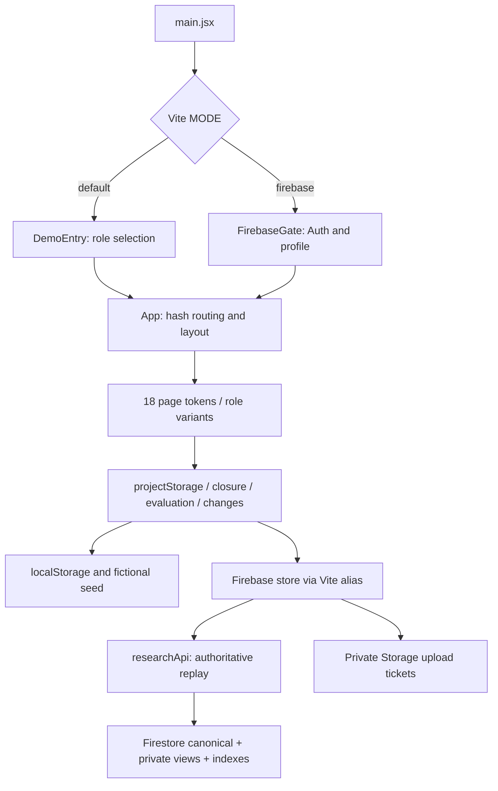

# System Overview — Audit & Demo Redesign Planning

วันที่: 14 November 2026 (Asia/Bangkok) · Personal Research Grant Management System for Mae Fah Luang University · 404 Team Found

Repository baseline: HEAD `261426d` พร้อม uncommitted changes ที่มีอยู่ก่อนงานนี้; ผล audit อ้าง working tree ดังที่พบ ไม่ได้อ้าง HEAD เพียงอย่างเดียว

สถานะเอกสาร: **ข้อค้นพบจาก source code และข้อเสนอเพื่อให้ผู้ใช้ตัดสินใจ ยังไม่ใช่การอนุมัติพัฒนา**. งานนี้เขียนเอกสารใน docs/audit เท่านั้น ไม่แก้ application, UI, Backend, Database หรือ API และไม่ deploy/seed remote data

## ข้อสรุปที่ต้องใช้ประกอบการตัดสินใจ

Demo มีพื้นฐานฟอร์ม RS-1, import PDF/DOCX, proposal PDF, หน้าโครงการ, เอกสาร, การตรวจข้อเสนอ, closure สองเส้นทาง และแบบประเมินที่บันทึกได้จริงใน localStorage. มี Firebase adapter/authorization แยกอีกโหมด แต่ workflow ยังเป็นแบบเดิม ไม่ตรง 9 State ID ของ v1.6. ปัญหาหลักจึงเป็น domain/permissions/data ก่อนการจัดหน้าจอ

ต้องแก้ก่อนสาธิตว่าตรง v1.6: สถานะหลักและ self-transitions, signed RS-1/affiliation/consent gate, staff-only change records, fixed 3 reviewers + 3/3 release, single review round, evaluation PDF on-demand และ CANCELLED/TR-17. Readable Report ปัจจุบันยังแทรกข้อความ/ตัวเลขสมมติที่ไม่มาจาก PDF จริง

## เอกสารอ้างอิงที่อ่านและตรวจเวอร์ชัน

ผู้ใช้ยืนยันตำแหน่งใหม่ระหว่าง audit ว่าอยู่ที่ **C:/Users/User/Downloads/เอกสารความต้องการ/**. เอกสารครบหกประเภท ทุกฉบับระบุ v1.6 — Stakeholder Change Integration, 14 November 2026 (State ระบุวันที่ภาษาไทย)

| Reference | ตำแหน่งจริง | วิธีใช้อ้างอิง |
|---|---|---|
| Project rules | C:/Users/User/mfu-research-system/AGENTS.md | อ่านกฎเดิม; paths ใน AGENTS ยังชี้ตำแหน่งก่อนย้าย ห้ามใช้ path เก่าแล้วเงียบไปอ่านฉบับอื่น |
| Requirements | C:/Users/User/Downloads/เอกสารความต้องการ/requirement (1).md | แหล่งหลัก FR/NFR/BR/AC ในแถว FR, Scope, Open Questions |
| Workflow | C:/Users/User/Downloads/เอกสารความต้องการ/Workflow (1).md | end-to-end; email เป็น side event, PDF optional |
| User Flow | C:/Users/User/Downloads/เอกสารความต้องการ/User Flow.md | task sequence ของ 3 บทบาท |
| Use Case Diagram | C:/Users/User/Downloads/เอกสารความต้องการ/Use Case Diagram (1).md | actor/capabilities; diagram ไม่ยืนยันสิทธิ์ที่ยัง OPEN |
| Use Case Specification | C:/Users/User/Downloads/เอกสารความต้องการ/Use Case Specification (1).md | 3.1–3.18 รวม cancellation/release/PDF |
| State Specification | C:/Users/User/Downloads/เอกสารความต้องการ/State Transition Diagram (1).md | 9 states, TR-01–TR-17, AC-TR-05/09/10/14/15/16/17 |
| Supporting README | C:/Users/User/Downloads/เอกสารความต้องการ/README (1).md | บริบท ไม่ใช้ยืนยัน Requirement |

พบอีกไฟล์ C:/Users/User/Downloads/requirement.md ที่ระบุ v1.6 วันเดียวกันแต่เพิ่มรหัส AC รายข้อ; SHA-256 ต่างกัน. เปรียบเทียบ FR/BR/NFR/OPEN 123 แถวหลังตัด AC labels และ normalize ตัวแบ่งแล้วไม่พบความต่างของข้อความแถว. รายงานนี้เลือกชุดที่ผู้ใช้ชี้เป็นหลัก และอ้าง AC ด้วย FR + คอลัมน์ AC ของแถวนั้น รวม AC-TR จาก State; **ไม่ถือว่าฉบับเพิ่มรหัส AC ได้รับเลือกแทนชุดหลักเอง**

ไม่มีเอกสารในหกประเภทที่ขาดหลังทราบตำแหน่งใหม่. เอกสารต้นทาง RS-1 ไทย/อังกฤษ แบบประเมินจริง Excel ทะเบียนและหลักเกณฑ์ 2569/ขั้นตอน2570 ไม่ได้ถูกส่งเป็นส่วนของชุดนี้ จึงยังตรวจข้อกำหนดที่ต้องเทียบต้นทางเหล่านั้นไม่ได้. ตำแหน่งใหม่บันทึกใน audit นี้; ไม่แก้ AGENTS ในงานที่กำหนด output เฉพาะ audit

## วิธีตรวจและขอบเขตหลักฐาน

อ่าน entry points, router + branch rendering, page handlers/forms, reachable และ legacy components, utils/domain reducers, seed data, API replay, Firestore/Storage rules, build config และ tests. ตรวจทั้ง uncommitted working tree ไม่จำกัด HEAD. ไม่อ่านค่า secrets/.env/account passwords และไม่ติดต่อ production

- Static source tracing: main → DemoEntry/FirebaseGate → App → pages → reducers/store/API → rules/indexes
- Executed logic: node --test tests/*.test.js **ผ่าน 67/67**, 0 fail/skip. เรียกตรงเพื่อหลีกเลี่ยง pretest ที่ copy domain files. Tests ผ่านสำหรับพฤติกรรมเดิม ไม่ใช่ conformance certificate ของ v1.6
- In-memory probes: สร้าง fixtures และเรียก pure reducers ไม่เขียน localStorage/Firestore: seed=12 projects; 1 reviewer ถือว่าครบและ release ได้; revised submit เข้ารอบ2; ยื่น proposal โดยไม่มี signed/affiliation evidence ได้ unit_review; extension จาก draft ไป endDate2029 ได้
- ไม่ได้รัน browser walkthrough, screenshot/visual QA, live Firebase Auth/Storage/emulator integration, deployed URL หรือการส่งอีเมลจริง. Working หมายถึง logic ที่ตรวจ ไม่ใช่การรับรอง UI ทุก viewport/ระบบ remote
- มีการเปลี่ยน application files เดิมอยู่ก่อน audit; ไม่แก้/ย้อนงานเหล่านั้น. เอกสารต้องอ่านเทียบ snapshot นี้หาก code เปลี่ยนภายหลัง

## โครงสร้างปัจจุบัน

### Runtime modes

| Layer | Default local Demo | Firebase MODE |
|---|---|---|
| Entry | DemoEntry; เลือก role ไม่ใช่ login | FirebaseGate; email/password + users profile |
| Store | sharedStore.js; localStorage | Vite alias sharedStore → firebaseSharedStore |
| Identity | demo-user/demo-staff/demo-reviewer | verified Firebase UID, role/workspace/active server profile |
| Read | canRead ที่ client; data ทั้งหมดอยู่ browser | staff canonical workspace projects; researcher/reviewer private projections |
| Write | pure reducer + saveProjects | prepareFiles → POST researchApi save → replayProject + transaction + optimistic version |
| Files | data URL PDF; import DOCX metadata | ticket + authenticated Storage; Storage must explicitly enabled |
| Notifications | statusHistory + role read watermark | per-account Firestore notifications + readAt/isRead |
| Email | ไม่มี sender/scheduler | ไม่พบ sender/scheduler; notification record ไม่เท่ากับ email |

src/utils/firebaseClient.js export firebaseMode=true เป็นค่าของโมดูล Firebase ไม่ใช่ตัวตัดสิน entry; ตัวตัดสินจริงคือ MODE ใน main และ Vite alias. README คำกล่าวว่า backend inactive จึงจริงเฉพาะ default mode

### API / Database ที่พบ

- functions/index.js: researchApi POST + Bearer ID token; actions prepareUpload และ save. demoApi ตอบ410 retired. ไม่มี e-Office API และไม่เสนอเพิ่ม
- securePolicy.replayProject อ่าน action จาก candidate history แล้ว replay ด้วย actor/time ฝั่ง server; ไม่เขียน candidate ตรง. reviewer assign server ยอมรับ **1–10** คน ไม่ใช่ exactly3
- canonical: users/{uid}, workspaces/{workspace}/projects/{id}, activity subcollection; private views: workspaces/{workspace}/users/{uid}/projects/{id}; notifications ใน user scope; uploadTickets private
- indexes ที่ server เขียน: projects, projectDocuments, reviewAssignments, reviews, activityLogs. การมี collection ไม่ได้หมายถึง UI ทะเบียนเปิดได้ครบ
- Firestore direct project writes ถูกปิด; write ผ่าน Admin API. Storage create PDF≤2MB + ticket; update/delete denied; protected reads. Runtime rules ยังไม่ทดสอบใหม่ใน audit
- functions/policy.js ยังมี legacy stages/workshop expiration; researchApi ใช้ securePolicy ไม่เรียก authorizeWorkshop. อย่าอ้างว่า expiration30Nov บังคับ authenticated API โดยอัตโนมัติ
- functions/domain เป็นสำเนาจาก scripts/sync-server-domain.mjs. ต้องตรวจ/sync ให้ตรงเมื่อแก้จริง ไม่แก้สำเนาใน audit นี้
- functions/demo/advisorBundle.mjs มีการสร้าง PDF ข้อเสนอแนะสมมติสำหรับชุด seed แบบ offline แต่ไม่ใช่ on-demand generator ของผลประเมินที่ผู้ใช้งานส่งผ่านหน้าแอป จึงยังไม่ถือว่า FR-REV-07 ถูก implement แล้ว

## เป้าหมาย v1.6 ที่ต้องคง

3 บทบาท Researcher, Research Administration Staff, Expert Reviewer; ต้นสังกัด/คณะกรรมการไม่มีบัญชี Web; คณะกรรมการเพื่อทราบ. 9 states: DRAFT, AFFILIATION_REVIEW, STAFF_REVIEW, COMMITTEE_ACKNOWLEDGEMENT, IN_PROGRESS, CLOSURE_REVIEW, REPORT_EVALUATION, CLOSED, CANCELLED. CLOSED กับ CANCELLED เป็นคนละ terminal. TR-01–TR-17 เท่านั้นตามเงื่อนไขที่ยืนยันแล้ว

เส้นทางเผยแพร่ไม่ผ่าน Reviewer; รายงาน5บทประเมินหนึ่งรอบโดย3คน → staff release3/3 → researcher revised upload → staff close. Preview/download/upload/save อย่างเดียวไม่เปลี่ยน state; e-Office ภายนอก; signed RS-1+affiliation evidence+consent ตามกรณีก่อน TR-05; extension2×≤6เดือน ไม่ auto-cancel2ปี; audit เก็บย้อนหลัง

## ข้อกำหนดกับข้อเสนอแยกกัน

CONFIRMED/PROCESS/DESIGN/OPEN ใน Requirement ไม่เหมือน Recommended Action/Priority ของแผน. ทุกชื่อหน้าใหม่ route ใหม่ merge/split/layout และลำดับ P0–P3 ในรายงานนี้เป็น **AUDIT DESIGN PROPOSAL**. การอ้าง Requirement ที่เป็น DESIGN ไม่เปลี่ยนให้เป็น stakeholder-confirmed. OPEN ที่กระทบการพัฒนาต้องได้คำตอบก่อนเปิดใช้เงื่อนไขนั้น ไม่หยุดงานส่วนที่ไม่ขึ้นต่อคำตอบ

อ่านต่อ: [Page Inventory](02_CURRENT_PAGE_INVENTORY.md), [Feature Inventory](03_CURRENT_FEATURE_INVENTORY.md), [Gap Analysis](04_GAP_ANALYSIS.md), [Proposed Structure](05_PROPOSED_PAGE_STRUCTURE.md), [Revision Plan](06_DEMO_REVISION_PLAN.md)

## Reference fingerprints และ Source evidence index

SHA-256 ใช้ระบุ snapshot ของเอกสารที่ใช้จริง หากเอกสารเปลี่ยนต้องทบทวน audit ไม่ใช้วัน/ชื่อไฟล์อย่างเดียว

| Document | SHA-256 |
|---|---|
| requirement (1).md | 116ab472d17f37181c0274b73311881f5a12a42b75c0335dd846cd827bf37f5c |
| Workflow (1).md | fe1adf17de6aa1fab8645f4ee0b134020549536670e7603fedd2bc16d158cd2e |
| User Flow.md | bf458546fdadb7d26332542242be2e494689c616207cb5cb974952c7399ccf24 |
| Use Case Diagram (1).md | 18feb6d23e9a89ba63a48533235d7a014c8a6be4be90733b113228041de09589 |
| Use Case Specification (1).md | f9ce775be17ba0d6b4ff2fb3dbdbc89634f3f6700d44ae3ec50a823c16c28b58 |
| State Transition Diagram (1).md | 90a11e0e0d0018e6da6eb91c0c5684c3ad5fb7823b07a661e0e6b2a1608bf0bf |

| Evidence | Source anchor (one-based line) |
|---|---|
| main mode | `src/main.jsx:6` |
| router tokens | `src/utils/demoRouter.js:4` |
| route guards | `src/App.jsx:62` |
| local directory | `src/utils/sharedStore.js:4` |
| old states | `src/data/statuses.js:1` |
| proposal submit state | `src/utils/projectStorage.js:102` |
| assignment completion | `src/utils/evaluation.js:16` |
| round2 | `src/utils/closure.js:44` |
| early final flag | `src/utils/closure.js:86` |
| server1-10 | `functions/securePolicy.js:51` |
| view projection | `functions/securePolicy.js:95` |
| readable mock | `src/pages/ProjectDocuments.jsx:13` |
| extension eligibility | `src/utils/projectChanges.js:14` |
| unreachable closed forms | `src/pages/ClosureWorkspace.jsx:59` |
| source import provenance | `src/pages/UploadDocument.jsx:353` |
| evaluation result props | `src/pages/ReviewerEvaluation.jsx:12` |
| API authoritative save | `functions/index.js:56` |
| Firestore write guards | `firestore.rules:17` |
| Storage feedback privacy | `storage.rules:12` |
| reround baseline test | `tests/reviewerScenarios.test.js:59` |

Source/domain byte parity ณ audit: ไฟล์ JS ที่มีคู่ใน functions/domain/src ตรงกับ src แบบ byte-for-byte. ไม่ได้รัน sync หรือเขียน application files

### Source inventory ที่ใช้ตรวจขอบเขต

ตารางนี้ใช้ตรวจความครบของไฟล์และ reachability ร่วมกับรายละเอียด handler/reducer ใน02–04 ไม่ใช้จำนวนไฟล์แทนจำนวนหน้า. Assets/PDF/fonts/lockfiles/env/secrets ไม่ใช่ application page code; tests/seed/deployment scripts เป็นsupporting code ไม่ใช่หน้า

| Source file | Lines | Category |
|---|---|---|
| `src/App.css` | 3554 | Entry/layout/style/locale |
| `src/App.jsx` | 98 | Entry/layout/style/locale |
| `src/components/AdvisorShowcase.jsx` | 10 | Component (not a page) |
| `src/components/DataConnection.jsx` | 2 | Component (not a page) |
| `src/components/DemoEntry.jsx` | 23 | Component (not a page) |
| `src/components/DemoScenarios.jsx` | 16 | Component (not a page) |
| `src/components/DocumentPreview.jsx` | 42 | Component (not a page) |
| `src/components/ErrorBoundary.jsx` | 10 | Component (not a page) |
| `src/components/FirebaseGate.jsx` | 93 | Component (not a page) |
| `src/components/Header.jsx` | 121 | Component (not a page) |
| `src/components/LanguageSwitcher.jsx` | 1 | Component (not a page) |
| `src/components/ProjectTable.jsx` | 1 | Component (not a page) |
| `src/components/ProposalPDF.jsx` | 28 | Component (not a page) |
| `src/components/ResearchDocuments.jsx` | 9 | Component (not a page) |
| `src/components/ReviewerDemoPreview.jsx` | 51 | Component (not a page) |
| `src/components/ReviewerSteps.jsx` | 4 | Component (not a page) |
| `src/components/Sidebar.css` | 178 | Component (not a page) |
| `src/components/Sidebar.jsx` | 53 | Component (not a page) |
| `src/components/StaffRegistry.css` | 16 | Component (not a page) |
| `src/components/StaffRegistry.jsx` | 102 | Component (not a page) |
| `src/components/StatusBadge.jsx` | 1 | Component (not a page) |
| `src/components/SummaryCard.jsx` | 1 | Component (not a page) |
| `src/components/WorkQueue.jsx` | 32 | Component (not a page) |
| `src/data/demoAttachment.js` | 8 | State/seed/registry data |
| `src/data/demoProjects.js` | 42 | State/seed/registry data |
| `src/data/demoRegistry.js` | 30 | State/seed/registry data |
| `src/data/interactiveDemo.js` | 72 | State/seed/registry data |
| `src/data/registry.js` | 25 | State/seed/registry data |
| `src/data/statuses.js` | 19 | State/seed/registry data |
| `src/design.css` | 285 | Entry/layout/style/locale |
| `src/i18n.js` | 27 | Entry/layout/style/locale |
| `src/index.css` | 17 | Entry/layout/style/locale |
| `src/locales/en.json` | 159 | Entry/layout/style/locale |
| `src/locales/th.json` | 159 | Entry/layout/style/locale |
| `src/main.jsx` | 15 | Entry/layout/style/locale |
| `src/pages/ActiveProjectDetail.css` | 430 | Page style |
| `src/pages/ActiveProjectDetail.jsx` | 602 | Legacy page, not mounted |
| `src/pages/AdministrativeRecords.jsx` | 34 | Current page implementation |
| `src/pages/ChooseSubmissionMethod.jsx` | 69 | Current page implementation |
| `src/pages/Closure.css` | 44 | Page style |
| `src/pages/ClosureWorkspace.jsx` | 132 | Current page implementation |
| `src/pages/CorrectionRequest.jsx` | 12 | Current page implementation |
| `src/pages/Dashboard.jsx` | 134 | Legacy page, not mounted |
| `src/pages/EvaluationResults.jsx` | 10 | Current page implementation |
| `src/pages/FocusedDemo.css` | 88 | Page style |
| `src/pages/ManualEntry.jsx` | 664 | Current page implementation |
| `src/pages/MyProjects.jsx` | 271 | Legacy page, not mounted |
| `src/pages/Notifications.jsx` | 114 | Current page implementation |
| `src/pages/ProjectChangeRecord.css` | 36 | Page style |
| `src/pages/ProjectChangeRecord.jsx` | 122 | Current page implementation |
| `src/pages/ProjectDetail.jsx` | 473 | Current page implementation |
| `src/pages/ProjectDocuments.jsx` | 17 | Current page implementation |
| `src/pages/ProjectList.jsx` | 26 | Current page implementation |
| `src/pages/ProposalReview.jsx` | 363 | Current page implementation |
| `src/pages/Reviewer.css` | 15 | Page style |
| `src/pages/ReviewerDashboard.jsx` | 20 | Current page implementation |
| `src/pages/ReviewerEvaluation.jsx` | 65 | Current page implementation |
| `src/pages/RoleOverview.jsx` | 14 | Current page implementation |
| `src/pages/StaffDashboard.jsx` | 409 | Legacy page, not mounted |
| `src/pages/StaffOverview.jsx` | 55 | Current page implementation |
| `src/pages/StaffProjectList.jsx` | 72 | Current page implementation |
| `src/pages/SubmissionConfirmation.jsx` | 307 | Current page implementation |
| `src/pages/UploadDocument.jsx` | 710 | Current page implementation |
| `src/utils/administrativeRecords.js` | 14 | Logic/store/helper |
| `src/utils/closure.js` | 151 | Logic/store/helper |
| `src/utils/closureRegistry.js` | 39 | Logic/store/helper |
| `src/utils/deadlines.js` | 10 | Logic/store/helper |
| `src/utils/demoCorrection.js` | 13 | Logic/store/helper |
| `src/utils/demoRouter.js` | 96 | Logic/store/helper |
| `src/utils/documents.js` | 6 | Logic/store/helper |
| `src/utils/evaluation.js` | 31 | Logic/store/helper |
| `src/utils/firebaseClient.js` | 42 | Logic/store/helper |
| `src/utils/firebaseFiles.js` | 53 | Logic/store/helper |
| `src/utils/firebaseSharedStore.js` | 76 | Logic/store/helper |
| `src/utils/generateRS1PDF.js` | 267 | Logic/store/helper |
| `src/utils/handoff.js` | 23 | Logic/store/helper |
| `src/utils/navigationGuard.js` | 11 | Logic/store/helper |
| `src/utils/pdfAttachment.js` | 7 | Logic/store/helper |
| `src/utils/projectChanges.js` | 54 | Logic/store/helper |
| `src/utils/projectStorage.js` | 125 | Logic/store/helper |
| `src/utils/proposalDraft.js` | 18 | Logic/store/helper |
| `src/utils/proposalSubmission.js` | 39 | Logic/store/helper |
| `src/utils/proposalValidation.js` | 61 | Logic/store/helper |
| `src/utils/registry.js` | 45 | Logic/store/helper |
| `src/utils/reviewerPresentation.js` | 24 | Logic/store/helper |
| `src/utils/sharedStore.js` | 12 | Logic/store/helper |
| `src/utils/staffProjects.js` | 43 | Logic/store/helper |
| `src/utils/useDemoRoute.js` | 4 | Logic/store/helper |
| `src/utils/useFormDraft.js` | 52 | Logic/store/helper |
| `src/utils/useLiveProjects.js` | 16 | Logic/store/helper |
| `src/workspace.css` | 90 | Entry/layout/style/locale |
