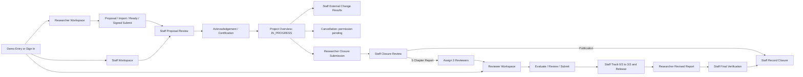

# Proposed Page Structure — Design Proposal

**ทุก route/layout/page grouping ในเอกสารนี้เป็นข้อเสนอ AUDIT DESIGN PROPOSAL รอผู้ใช้ตัดสินใจ ไม่ใช่คำยืนยัน Stakeholder และไม่ใช่หน้าที่สร้างแล้ว**. Requirements references คงป้ายเดิม; CONFIRMED/PROCESS/DESIGN/OPEN ไม่เท่ากับ KEEP/ADDฯลฯ. มี31 functional page definitions รวมsharedviews; N-V02reuseN-X02จึงไม่ใช่31uniqueURLtemplates และห้ามเทียบตรงกับ21currenttypes

## หลักการจัดโครงสร้าง

- Common shellเดียว: authenticatedidentity,sidebar,breadcrumb,nextaction,projectcontext,documentversion,audit. Component reuseไม่บังคับให้workflowactionsอยู่หน้าเดียว
- Researcher: Dashboard → My Projects → Proposal Editor/Import → PDF Ready → Signed Submission → Track → Closure หรือ Released Feedback/Revised Report
- Staff: Dashboard/Registry → Proposal Review → Acknowledgement/Certification → Change Results → Closure Review → 3ReviewerAssignment → Tracking/Release → Final Verification/Close; Cancellationactionเปิดเมื่อpermissionยืนยัน
- Reviewer: Assigned Reviews → Report → Evaluation → Review/Submit → Own Result/PDF; ไม่มีre-evaluationloop
- Sharedอ่านProject/Files/History/Notificationsตามrole. ไม่สร้างบทบาทหรือmainstatesเพิ่ม ไม่เพิ่มeOfficeAPI. PDFเป็นactionในresults/documentsไม่ใช่mandatorywizardstep

## รายการหน้าเสนอใหม่

Priority: P0 Core Workflow; P1 Important Features; P2 Supporting Features; P3 UI/UX Improvements. P0ที่ติดOPENยังคงPENDINGจนมีคำตอบ;ไม่ลดความสำคัญเพียงเพราะยังimplementไม่ได้

| Proposed ID | Page | Role | Existing Mapping | Action | Priority | Phase |
|---|---|---|---|---|---|---|
| N-C01 | Demo Scenario Entry | Common | C01; DemoScenarios | REDESIGN | P2 | 1 |
| N-C02 | Sign In | Common | C02 | MODIFY | P0 | 1 |
| N-C03 | Not Found / Access Denied | Common | C03; App error branches | MODIFY | P1 | 1 |
| N-X01 | Project Overview | Shared | R07/S03/V03; legacyActiveProjectDetail | MERGE | P0 | 1 |
| N-X02 | Project Document Library / Report Reader | Shared | R09/S05/V05; ProjectDocuments/ResearchDocuments | REDESIGN | P0 | 1 |
| N-X03 | Project Activity & History | Shared | R08/S04/V04; historyหลายcomponent | MERGE | P1 | 1 |
| N-X04 | Notifications & Tasks | Shared | R13/S12/V09 | MODIFY | P1 | 1 |
| N-R01 | Researcher Dashboard | Researcher | R01; legacyDashboard | MODIFY | P1 | 2 |
| N-R02 | My Projects | Researcher | R02; MyProjects legacy | MERGE | P0 | 2 |
| N-R03 | RS-1 Proposal Editor | Researcher | R03/R05; ManualEntry | REDESIGN | P0 | 2 |
| N-R04 | RS-1 Import & Extraction Review | Researcher | R04 | MODIFY | P1 | 2 |
| N-R05 | Proposal PDF & Affiliation Preparation | Researcher | R05/R06 ProposalPDF | SPLIT | P0 | 2 |
| N-R06 | Signed Proposal Submission | Researcher | R06 | REDESIGN | P0 | 2 |
| N-R07 | Closure Submission | Researcher | R11 ResearcherForm | SPLIT | P0 | 2 |
| N-R08 | Revised Final Report Submission | Researcher | R11 post-evaluationbranch | SPLIT | P0 | 2 |
| N-R09 | Released Evaluation Results | Researcher | R12 | MODIFY | P0 | 2 |
| N-S01 | Staff Dashboard | Research Administration Staff | S01; legacyStaffDashboard | REDESIGN | P1 | 3 |
| N-S02 | Project Registry & Work Queues | Research Administration Staff | S02 + threequeuevariants; legacyStaffRegistry | MERGE | P0 | 3 |
| N-S03 | Proposal Review | Research Administration Staff | S06 | MODIFY | P0 | 3 |
| N-S04 | Committee Acknowledgement & Certification Record | Research Administration Staff | S07 committee/activebranch | SPLIT | P0 | 3 |
| N-S05 | External Change & Extension Results | Research Administration Staff | S08 + S09/R10oldcorrection | MERGE | P0 | 3 |
| N-S06 | Closure Document Review | Research Administration Staff | S10 StaffForm check/publicationbranch | SPLIT | P0 | 3 |
| N-S07 | Assign Three Expert Reviewers | Research Administration Staff | S10 embeddedassignment | SPLIT | P0 | 3 |
| N-S08 | Evaluation Tracking & Release | Research Administration Staff | S11 + S10FinalVerification + legacyAdvisorShowcase | REDESIGN | P0 | 3 |
| N-S09 | Final Report Verification & Closure | Research Administration Staff | S10 FinalVerification/ClosureNotice/ClosedContent | SPLIT | P0 | 3 |
| N-S10 | Cancellation Record | Authorized actor (permission PENDING) | ไม่มีหน้าเดิม;registrylabelไม่ใช่cancel | PENDING | P0 | 3 |
| N-V01 | Assigned Reviews Workspace | Expert Reviewer | V01/V02 | MERGE | P0 | 4 |
| N-V02 | Assigned Report Reader | Expert Reviewer | V03/V05; sharedN-X02 | MERGE | P0 | 4 |
| N-V03 | Evaluation Editor | Expert Reviewer | V06 | MODIFY | P0 | 4 |
| N-V04 | Evaluation Review & Submit | Expert Reviewer | V07 | KEEP | P0 | 4 |
| N-V05 | My Submitted Evaluation | Expert Reviewer | V08 | MODIFY | P1 | 4 |

## N-C01 — Demo Scenario Entry

| Field | Proposal |
|---|---|
| Page Name / User Role | Demo Scenario Entry / Common |
| Proposed Route | `#/demo` (ยังไม่สร้าง) |
| Purpose | เริ่มสาธิตโดยแยกจากระบบบัญชี |
| Required Features | 3rolepersona; v1.6scenariofixtures; clearmocklabels; resetlocalonly |
| Required Components | RoleCards,ScenarioCatalog,DemoNotice |
| User Actions | Select persona/scenario; resetwithconfirm |
| Business Rules | เป็นsimulationไม่ใช่Auth;ไม่แก้realrecords |
| Related State Transitions | ไม่มี |
| Requirement References | NFR-10; FR-COM-01 (demoexceptionต้องlabel); ACในแถวFRเหล่านี้และAC-TRเมื่อมี |
| Existing Page Mapping | C01; DemoScenarios |
| Recommended Action | **REDESIGN** |
| Priority | **P2** |
| Dependency / Decision | T00 |
| Review / acceptance focus | เข้าroleถูก;resetเฉพาะfixture;ไม่แสดงreal-loginclaim |
| Requirement approval boundary | การจัดหน้าจอเป็นDESIGN PROPOSAL;ไม่ยกระดับFRที่เป็นDESIGNหรือOPENเป็นCONFIRMED |

## N-C02 — Sign In

| Field | Proposal |
|---|---|
| Page Name / User Role | Sign In / Common |
| Proposed Route | `#/login` (ยังไม่สร้าง) |
| Purpose | เข้าสู่บัญชีที่มีสิทธิ์ |
| Required Features | email/password; restoreprofile; pending/error/denied; signout |
| Required Components | AuthForm,SessionGate,AccessError |
| User Actions | Sign in/out |
| Business Rules | roleจากserverprofile;3roleเท่านั้น;ไม่เพิ่มregistration/adminroleนอกscope |
| Related State Transitions | ไม่มี |
| Requirement References | FR-COM-01/02; NFR-01/02; ACในแถวFRเหล่านี้และAC-TRเมื่อมี |
| Existing Page Mapping | C02 |
| Recommended Action | **MODIFY** |
| Priority | **P0** |
| Dependency / Decision | T00 |
| Review / acceptance focus | disabledprofile/wrongroleURL/expiredsessionถูกปฏิเสธ;ไม่มีlocalfallbackเงียบ |
| Requirement approval boundary | การจัดหน้าจอเป็นDESIGN PROPOSAL;ไม่ยกระดับFRที่เป็นDESIGNหรือOPENเป็นCONFIRMED |

## N-C03 — Not Found / Access Denied

| Field | Proposal |
|---|---|
| Page Name / User Role | Not Found / Access Denied / Common |
| Proposed Route | `#/not-found; embeddedpermissionerrors` (ยังไม่สร้าง) |
| Purpose | สื่อสารerrors/emptyโดยไม่เปิดข้อมูล |
| Required Features | 404/403/projectmissing/loading/retryแยกข้อความเหมาะสม |
| Required Components | ErrorState,EmptyState,RetryAction |
| User Actions | Back; retryauthorizedread |
| Business Rules | ไม่เปิดเผยชื่อโครงการที่ไม่มีสิทธิ์;routeparse+capabilityguard |
| Related State Transitions | ไม่มี |
| Requirement References | FR-COM-02/04; NFR-08; ACในแถวFRเหล่านี้และAC-TRเมื่อมี |
| Existing Page Mapping | C03; App error branches |
| Recommended Action | **MODIFY** |
| Priority | **P1** |
| Dependency / Decision | N-C02 |
| Review / acceptance focus | deep-linkinvalid/forbiddenไม่renderข้อมูลหรือฟอร์มอื่น |
| Requirement approval boundary | การจัดหน้าจอเป็นDESIGN PROPOSAL;ไม่ยกระดับFRที่เป็นDESIGNหรือOPENเป็นCONFIRMED |

## N-X01 — Project Overview

| Field | Proposal |
|---|---|
| Page Name / User Role | Project Overview / Shared |
| Proposed Route | `#/{role}/projects/:id` (ยังไม่สร้าง) |
| Purpose | จุดเริ่มงานโครงการตามสิทธิ์ |
| Required Features | 9statebadge; nextaction; keydates; information/research/budget; terminalread-onlysummary; changes/cancellationresult |
| Required Components | ProjectShell,StateBadge,NextAction,ProjectFacts,RoleActionBar |
| User Actions | Opendocuments/history; editeligibleproposal; stafftasklinks |
| Business Rules | reviewerเห็นเฉพาะnecessaryassignmentcontext;CLOSED/CANCELLEDแยก;ไม่มีgenericstatusdropdown |
| Related State Transitions | แสดงTRทั้งหมด;ไม่triggerด้วยการอ่าน |
| Requirement References | FR-COM-04; FR-RES-18/20; FR-CLS-12; FR-REG-03; ACในแถวFRเหล่านี้และAC-TRเมื่อมี |
| Existing Page Mapping | R07/S03/V03; legacyActiveProjectDetail |
| Recommended Action | **MERGE** |
| Priority | **P0** |
| Dependency / Decision | T00,N-C02 |
| Review / acceptance focus | 9 statesแสดงถูก;terminalไม่มีedit/closureของcancelled;roleactionถูก |
| Requirement approval boundary | การจัดหน้าจอเป็นDESIGN PROPOSAL;ไม่ยกระดับFRที่เป็นDESIGNหรือOPENเป็นCONFIRMED |

## N-X02 — Project Document Library / Report Reader

| Field | Proposal |
|---|---|
| Page Name / User Role | Project Document Library / Report Reader / Shared |
| Proposed Route | `#/{role}/projects/:id/documents` (ยังไม่สร้าง) |
| Purpose | อ่านไฟล์จริงและเลือกเวอร์ชัน |
| Required Features | filterkind/version; PDFpreview/download; source/signed/affiliation/report/publicationfiles; reviewerassignedreportonly |
| Required Components | DocumentList,VersionSelector,PDFReader,AccessGate |
| User Actions | Select/open/download |
| Business Rules | noinventedreadablecontent;PDFactionไม่เปลี่ยนstate;reviewerไม่เห็นothersfeedback;postCLOSEDPDFpolicyPENDING |
| Related State Transitions | ไม่มี;ประกอบTR-05/11–16 |
| Requirement References | FR-RES-08/10; FR-SIG-06; FR-ADM-02; FR-REV-03/07; NFR-02/05; ACในแถวFRเหล่านี้และAC-TRเมื่อมี |
| Existing Page Mapping | R09/S05/V05; ProjectDocuments/ResearchDocuments |
| Recommended Action | **REDESIGN** |
| Priority | **P0** |
| Dependency / Decision | T00,N-C02,N-X01 |
| Review / acceptance focus | เปิดไฟล์ตรงversion+bytes;missingfileไม่fabricate;unauthorizedURLdenied;viewไม่เปลี่ยนstate |
| Requirement approval boundary | การจัดหน้าจอเป็นDESIGN PROPOSAL;ไม่ยกระดับFRที่เป็นDESIGNหรือOPENเป็นCONFIRMED |

## N-X03 — Project Activity & History

| Field | Proposal |
|---|---|
| Page Name / User Role | Project Activity & History / Shared |
| Proposed Route | `#/{role}/projects/:id/history` (ยังไม่สร้าง) |
| Purpose | ตรวจสอบย้อนหลังในที่เดียว |
| Required Features | statebranchhistory; actor/time/reason; documentversions; externalresults; before/after; cancellation; releaseevent |
| Required Components | ActivityTimeline,EventFilters,ChangeDiff |
| User Actions | Filter/page; authorizedfilelink |
| Business Rules | append-only;redactnestedarchives;timelineไม่บังคับทุกโครงการผ่านreportpath |
| Related State Transitions | อ่านTR-01–17 |
| Requirement References | FR-COM-05; FR-RES-19; FR-ADM-10; FR-CLS-11; NFR-03; ACในแถวFRเหล่านี้และAC-TRเมื่อมี |
| Existing Page Mapping | R08/S04/V04; historyหลายcomponent |
| Recommended Action | **MERGE** |
| Priority | **P1** |
| Dependency / Decision | T00,N-X01 |
| Review / acceptance focus | eventchronology/actor/previous-newถูก;publicationไม่แสดงว่าผ่านevaluation;ไม่มีผลผู้อื่นรั่ว |
| Requirement approval boundary | การจัดหน้าจอเป็นDESIGN PROPOSAL;ไม่ยกระดับFRที่เป็นDESIGNหรือOPENเป็นCONFIRMED |

## N-X04 — Notifications & Tasks

| Field | Proposal |
|---|---|
| Page Name / User Role | Notifications & Tasks / Shared |
| Proposed Route | `#/{role}/notifications` (ยังไม่สร้าง) |
| Purpose | รวมกิจกรรมและงานตามสิทธิ์ |
| Required Features | unread; relatedtask; deadlinesตามconfirmeddate; loading/error; emaildeliverylabelเฉพาะเมื่อมีsenderจริง |
| Required Components | NotificationList,TaskLink,DeadlineSummary |
| User Actions | Readall; opentask; paginate |
| Business Rules | noemailsentclaim;cadenceOPEN-10;ไม่ใช้การรับอีเมลเป็นprerequisite |
| Related State Transitions | ไม่มี;eventlinksไปTRที่เกี่ยวข้อง |
| Requirement References | FR-COM-05; FR-RES-19/20; UseCase3.8; NFR-03; ACในแถวFRเหล่านี้และAC-TRเมื่อมี |
| Existing Page Mapping | R13/S12/V09 |
| Recommended Action | **MODIFY** |
| Priority | **P1** |
| Dependency / Decision | T00,N-C02 |
| Review / acceptance focus | readmarksaccountscoped;ไม่เห็นothers;extensiondateสะท้อนใหม่;ไม่มีfakeemailstatus |
| Requirement approval boundary | การจัดหน้าจอเป็นDESIGN PROPOSAL;ไม่ยกระดับFRที่เป็นDESIGNหรือOPENเป็นCONFIRMED |

## N-R01 — Researcher Dashboard

| Field | Proposal |
|---|---|
| Page Name / User Role | Researcher Dashboard / Researcher |
| Proposed Route | `#/researcher/dashboard` (ยังไม่สร้าง) |
| Purpose | เห็นงานตนและสิ่งที่ต้องทำก่อน |
| Required Features | countsตาม9 states; pendingactions; recent; newproposal; deadlines |
| Required Components | SummaryCards,RecentProjects,TaskSummary |
| User Actions | Openlist/task; newproposal |
| Business Rules | owneronly;layoutเป็นdesignproposalไม่เพิ่มbusinessrule |
| Related State Transitions | ไม่มี |
| Requirement References | FR-COM-03/04; FR-RES-18/20; ACในแถวFRเหล่านี้และAC-TRเมื่อมี |
| Existing Page Mapping | R01; legacyDashboard |
| Recommended Action | **MODIFY** |
| Priority | **P1** |
| Dependency / Decision | N-X01,T00 |
| Review / acceptance focus | countsตรงlist;cancelledไม่active;tasklinkตามstate |
| Requirement approval boundary | การจัดหน้าจอเป็นDESIGN PROPOSAL;ไม่ยกระดับFRที่เป็นDESIGNหรือOPENเป็นCONFIRMED |

## N-R02 — My Projects

| Field | Proposal |
|---|---|
| Page Name / User Role | My Projects / Researcher |
| Proposed Route | `#/researcher/projects` (ยังไม่สร้าง) |
| Purpose | ค้นโครงการของตน |
| Required Features | search/status/pagination; terminalfilters; taskfilter; demoexamplesเป็นsecondaryview |
| Required Components | ProjectList,Filters,Pagination |
| User Actions | Search/clear/open/new |
| Business Rules | owneronly;สถานะเลือกจาก9StateID |
| Related State Transitions | ไม่มี |
| Requirement References | FR-COM-03; FR-RES-18/19; ACในแถวFRเหล่านี้และAC-TRเมื่อมี |
| Existing Page Mapping | R02; MyProjects legacy |
| Recommended Action | **MERGE** |
| Priority | **P0** |
| Dependency / Decision | N-X01,T00 |
| Review / acceptance focus | search+refresh+backรักษาfilters;ไม่เห็นโครงการอื่น |
| Requirement approval boundary | การจัดหน้าจอเป็นDESIGN PROPOSAL;ไม่ยกระดับFRที่เป็นDESIGNหรือOPENเป็นCONFIRMED |

## N-R03 — RS-1 Proposal Editor

| Field | Proposal |
|---|---|
| Page Name / User Role | RS-1 Proposal Editor / Researcher |
| Proposed Route | `#/researcher/projects/:id/proposal` (ยังไม่สร้าง) |
| Purpose | กรอก/แก้ร่างและrevisionที่อนุญาต |
| Required Features | manualform; reviewimportedvalues; save; fieldvalidation; structuredsignatories; budget; draftrecovery |
| Required Components | RS1Sections,ValidationSummary,SignatoryList,DraftControls |
| User Actions | Edit/save; openPDFready; resubmitcorrectionเมื่อtaskอนุญาต |
| Business Rules | ไม่แสดงWebapprovalหลังรับรอง;requiredfieldsOPEN-01/06/13;saveไม่transitionนอกจากinitialDRAFT |
| Related State Transitions | TR-01/02/04/06; TR-07 PENDING |
| Requirement References | FR-RES-01–03/06–09/12/16/17; FR-SIG-01; ACในแถวFRเหล่านี้และAC-TRเมื่อมี |
| Existing Page Mapping | R03/R05; ManualEntry |
| Recommended Action | **REDESIGN** |
| Priority | **P0** |
| Dependency / Decision | T00,N-X02; D01/D06เฉพาะfieldsที่ยังไม่ยืนยัน |
| Review / acceptance focus | save/reopenค่าตรง;unauthorizededitdenied;revisionคงSTAFF_REVIEW;ไม่เสียworkingdraft |
| Requirement approval boundary | การจัดหน้าจอเป็นDESIGN PROPOSAL;ไม่ยกระดับFRที่เป็นDESIGNหรือOPENเป็นCONFIRMED |

## N-R04 — RS-1 Import & Extraction Review

| Field | Proposal |
|---|---|
| Page Name / User Role | RS-1 Import & Extraction Review / Researcher |
| Proposed Route | `#/researcher/projects/:id/import` (ยังไม่สร้าง) |
| Purpose | ตรวจแก้ข้อมูลที่สกัดก่อนนำเข้าร่าง |
| Required Features | filevalidation; sourceversion; found/missing; editablemapping; explicitconfirm; clearvaluehandling |
| Required Components | UploadDropzone,SourcePreview,ExtractedFields,MappingErrors |
| User Actions | Upload/change; correct/clear; confirmtoform |
| Business Rules | ไม่สร้างค่าที่ไม่พบ;noOCRrequirementจนยืนยัน;types/accuracyOPEN |
| Related State Transitions | TR-02 |
| Requirement References | FR-RES-04–08; NFR-06/07; OPEN-01–03; ACในแถวFRเหล่านี้และAC-TRเมื่อมี |
| Existing Page Mapping | R04 |
| Recommended Action | **MODIFY** |
| Priority | **P1** |
| Dependency / Decision | N-R03,N-X02; D01 |
| Review / acceptance focus | badfileไม่ทำลายdraft;blankclearsintendedvalue;sourceprovenanceครบ;importไม่ส่งproposal |
| Requirement approval boundary | การจัดหน้าจอเป็นDESIGN PROPOSAL;ไม่ยกระดับFRที่เป็นDESIGNหรือOPENเป็นCONFIRMED |

## N-R05 — Proposal PDF & Affiliation Preparation

| Field | Proposal |
|---|---|
| Page Name / User Role | Proposal PDF & Affiliation Preparation / Researcher |
| Proposed Route | `#/researcher/projects/:id/ready` (ยังไม่สร้าง) |
| Purpose | แยกดูPDFกับยืนยันฉบับพร้อมยื่น |
| Required Features | preview/download; versionfreeze; completeness; signaturetemplate; readyconfirmation |
| Required Components | ProposalPDFPreview,VersionSummary,ReadyConfirmation |
| User Actions | Generate/preview/download; Confirmready |
| Business Rules | TR03triggerOPEN-04;การสร้าง/โหลดPDFลำพังไม่เปลี่ยนstate;externaldeliveryไม่อ้างreceived |
| Related State Transitions | TR-03 (PENDINGtrigger), TR-04 |
| Requirement References | FR-RES-09–12; FR-SIG-01; NFR-05; ACในแถวFRเหล่านี้และAC-TRเมื่อมี |
| Existing Page Mapping | R05/R06 ProposalPDF |
| Recommended Action | **SPLIT** |
| Priority | **P0** |
| Dependency / Decision | N-R03,N-X02; D02ก่อนenableconfirm |
| Review / acceptance focus | PDFตรงversion;preview/downloadสถานะเดิม;readytransitionเฉพาะtriggerที่ผู้ใช้ยืนยัน |
| Requirement approval boundary | การจัดหน้าจอเป็นDESIGN PROPOSAL;ไม่ยกระดับFRที่เป็นDESIGNหรือOPENเป็นCONFIRMED |

## N-R06 — Signed Proposal Submission

| Field | Proposal |
|---|---|
| Page Name / User Role | Signed Proposal Submission / Researcher |
| Proposed Route | `#/researcher/projects/:id/submit` (ยังไม่สร้าง) |
| Purpose | ตรวจbundleก่อนส่งให้staff |
| Required Features | signedfile+affiliationmeetingORconfirmation; signatorychecklist; consentconditional; receipt/idempotency |
| Required Components | EvidenceChecklist,FileUploader,ConsentAttestation,SubmitReview |
| User Actions | Attach/replace; confirmsignatures/consent; submit |
| Business Rules | FR-SIGtypes/proofOPEN-15/16;ไม่ตรวจลายเซ็นแท้เอง;servergateทั้งbundle |
| Related State Transitions | TR-05; TR-06ส่งใหม่ตามtask |
| Requirement References | FR-RES-13–17; FR-SIG-02–06; BR-03/04/11/12; ACในแถวFRเหล่านี้และAC-TRเมื่อมี |
| Existing Page Mapping | R06 |
| Recommended Action | **REDESIGN** |
| Priority | **P0** |
| Dependency / Decision | N-R05,N-X02,T00; D08เฉพาะfilepolicy |
| Review / acceptance focus | missingeachfile/consentปฏิเสธ;uploadstateunchanged;confirm→STAFF_REVIEWครั้งเดียว;staffอ่านbundleเดียวกัน |
| Requirement approval boundary | การจัดหน้าจอเป็นDESIGN PROPOSAL;ไม่ยกระดับFRที่เป็นDESIGNหรือOPENเป็นCONFIRMED |

## N-R07 — Closure Submission

| Field | Proposal |
|---|---|
| Page Name / User Role | Closure Submission / Researcher |
| Proposed Route | `#/researcher/projects/:id/closure` (ยังไม่สร้าง) |
| Purpose | ยื่นปิดสองเส้นทาง |
| Required Features | choosepath; report5chapterdraft OR summaryreport+publicationevidence; supportfiles; draft/confirm; extra-documentreply |
| Required Components | ClosurePathSelector,DocumentChecklist,UploadList,SubmissionReview |
| User Actions | Save/attach/remove/confirm; answerrequest |
| Business Rules | publicationnoreviewer;CANCELLEDไม่เข้า;criteriaOPEN-14;ไม่แทนeOfficeหนังสือ |
| Related State Transitions | TR-11/12 |
| Requirement References | FR-CLS-01–06; BR-07; ACในแถวFRเหล่านี้และAC-TRเมื่อมี |
| Existing Page Mapping | R11 ResearcherForm |
| Recommended Action | **SPLIT** |
| Priority | **P0** |
| Dependency / Decision | T00,N-X02,N-R02; D07 |
| Review / acceptance focus | pathfilesครบก่อนconfirm;save/uploadไม่transition;return/addคงCLOSURE_REVIEW |
| Requirement approval boundary | การจัดหน้าจอเป็นDESIGN PROPOSAL;ไม่ยกระดับFRที่เป็นDESIGNหรือOPENเป็นCONFIRMED |

## N-R08 — Revised Final Report Submission

| Field | Proposal |
|---|---|
| Page Name / User Role | Revised Final Report Submission / Researcher |
| Proposed Route | `#/researcher/projects/:id/revised-report` (ยังไม่สร้าง) |
| Purpose | ส่งฉบับแก้ไขหลังstaffrelease |
| Required Features | releasedfeedbacklink; newversionupload; instructions; receipt; additionaldocs |
| Required Components | ReleasedFeedbackSummary,VersionedUpload,RevisionChecklist |
| User Actions | Openresults; upload/submitrevision |
| Business Rules | ไม่เปิดก่อนrelease;ไม่ส่งReviewerอีกรอบ;reportversionแยกreviewround |
| Related State Transitions | TR-15 self;ไม่TR-16เอง |
| Requirement References | FR-CLS-09; FR-REV-08/10; ACในแถวFRเหล่านี้และAC-TRเมื่อมี |
| Existing Page Mapping | R11 post-evaluationbranch |
| Recommended Action | **SPLIT** |
| Priority | **P0** |
| Dependency / Decision | T00,N-X02,N-R09; finalintegrationหลังN-S08 |
| Review / acceptance focus | releaseแล้วแก้และส่งได้;newfileversionจริง;assignments/evaluationsเดิมไม่reset;ยังREPORT_EVALUATION |
| Requirement approval boundary | การจัดหน้าจอเป็นDESIGN PROPOSAL;ไม่ยกระดับFRที่เป็นDESIGNหรือOPENเป็นCONFIRMED |

## N-R09 — Released Evaluation Results

| Field | Proposal |
|---|---|
| Page Name / User Role | Released Evaluation Results / Researcher |
| Proposed Route | `#/researcher/projects/:id/evaluation-results` (ยังไม่สร้าง) |
| Purpose | อ่านผลที่staffเปิดเผยแล้ว |
| Required Features | 3individualsubmittedresults; releaseactor/time; individualPDFondemand; instructions |
| Required Components | EvaluationReadOnly,ReleaseBanner,PDFAction |
| User Actions | Read; downloadauthorizedPDF; goRevision |
| Business Rules | ก่อนreleaseไม่มีdata;combinedPDF/retention/postCLOSEDpending;ไม่รวมผลเป็นautodecision |
| Related State Transitions | TR-15 context;PDFnone |
| Requirement References | FR-REV-07/10; FR-CLS-09; NFR-05; ACในแถวFRเหล่านี้และAC-TRเมื่อมี |
| Existing Page Mapping | R12 |
| Recommended Action | **MODIFY** |
| Priority | **P0** |
| Dependency / Decision | T00,N-X01; finalintegrationN-S08; PDFserviceN-V05 |
| Review / acceptance focus | directURL/APIbefore-releasedenied;3ผลตรงsubmitted;PDFstateunchanged |
| Requirement approval boundary | การจัดหน้าจอเป็นDESIGN PROPOSAL;ไม่ยกระดับFRที่เป็นDESIGNหรือOPENเป็นCONFIRMED |

## N-S01 — Staff Dashboard

| Field | Proposal |
|---|---|
| Page Name / User Role | Staff Dashboard / Research Administration Staff |
| Proposed Route | `#/staff/dashboard` (ยังไม่สร้าง) |
| Purpose | จัดลำดับคิวstaff |
| Required Features | proposal/acknowledgement/closure/evaluation/finalqueues; deadlines; recent; cancelledsummary |
| Required Components | QueueCards,RecentProjects,WorkSummary |
| User Actions | Openfilteredqueue/project |
| Business Rules | workspace+staffscopeตามสิทธิ์;ไม่assigncancelpermissionเอง |
| Related State Transitions | ไม่มี |
| Requirement References | FR-ADM-01/08; FR-COM-03/04; ACในแถวFRเหล่านี้และAC-TRเมื่อมี |
| Existing Page Mapping | S01; legacyStaffDashboard |
| Recommended Action | **REDESIGN** |
| Priority | **P1** |
| Dependency / Decision | T00,N-S02 |
| Review / acceptance focus | countsตรงstates/tasks;0/3–3/3แยกจากmainstate |
| Requirement approval boundary | การจัดหน้าจอเป็นDESIGN PROPOSAL;ไม่ยกระดับFRที่เป็นDESIGNหรือOPENเป็นCONFIRMED |

## N-S02 — Project Registry & Work Queues

| Field | Proposal |
|---|---|
| Page Name / User Role | Project Registry & Work Queues / Research Administration Staff |
| Proposed Route | `#/staff/projects` (ยังไม่สร้าง) |
| Purpose | รวมรายการ/ทะเบียน/คิวโดยไม่ซ้ำหลายหน้า |
| Required Features | search/status/task/roundview; allowedregistryfields; pendingmappinglabels; archiveview |
| Required Components | ProjectTable,QueueFilters,RegistryColumns |
| User Actions | Search/open; exportเฉพาะถ้าภายหลังมอบหมายไม่รวมMVP |
| Business Rules | registryExcelmappingOPEN-21;noharddelete/noautomatedenrollmentblock;scopeworkspace |
| Related State Transitions | ไม่มี |
| Requirement References | FR-ADM-01/08; FR-REG-01–04; BR-01/16; ACในแถวFRเหล่านี้และAC-TRเมื่อมี |
| Existing Page Mapping | S02 + threequeuevariants; legacyStaffRegistry |
| Recommended Action | **MERGE** |
| Priority | **P0** |
| Dependency / Decision | T00,N-X01; D10/D11/D04เฉพาะunconfirmedfields |
| Review / acceptance focus | ทุกqueueเข้าprojecttaskถูก;ไม่มีunrestrictedstatusdropdown;registrypendingไม่mutatepolicy |
| Requirement approval boundary | การจัดหน้าจอเป็นDESIGN PROPOSAL;ไม่ยกระดับFRที่เป็นDESIGNหรือOPENเป็นCONFIRMED |

## N-S03 — Proposal Review

| Field | Proposal |
|---|---|
| Page Name / User Role | Proposal Review / Research Administration Staff |
| Proposed Route | `#/staff/projects/:id/proposal-review` (ยังไม่สร้าง) |
| Purpose | ตรวจsubmissionbundleและแจ้งแก้/ผ่าน |
| Required Features | structuredproposal+budget+signed/evidence/consentversion; reasonedrevision; reviewhistory |
| Required Components | ProposalSummary,EvidencePanel,ReviewChecklist,DecisionForm |
| User Actions | Openfiles; requestcorrection; recordpassed |
| Business Rules | requiredchecklistOPEN-06;returnไม่เพิ่มmainstate;ไม่committeeapprove |
| Related State Transitions | TR-06/08; TR-07 PENDING |
| Requirement References | FR-ADM-01–05/12; FR-SIG-06; FR-RES-16/17; ACในแถวFRเหล่านี้และAC-TRเมื่อมี |
| Existing Page Mapping | S06 |
| Recommended Action | **MODIFY** |
| Priority | **P0** |
| Dependency / Decision | N-R06,N-X02,T00; D01/D03สำหรับOPENparts |
| Review / acceptance focus | returnreasonrequired;researchertaskcreated;resubmitselfloop;pass→COMMITTEE_ACKNOWLEDGEMENT |
| Requirement approval boundary | การจัดหน้าจอเป็นDESIGN PROPOSAL;ไม่ยกระดับFRที่เป็นDESIGNหรือOPENเป็นCONFIRMED |

## N-S04 — Committee Acknowledgement & Certification Record

| Field | Proposal |
|---|---|
| Page Name / User Role | Committee Acknowledgement & Certification Record / Research Administration Staff |
| Proposed Route | `#/staff/projects/:id/acknowledgement` (ยังไม่สร้าง) |
| Purpose | บันทึกขั้นตอนภายนอกเพื่อทราบและรับรอง |
| Required Features | externalreference; meetingrecord; standardsmetadata/evidence; certificationevent |
| Required Components | ExternalReferenceForm,AcknowledgementRecord,StandardsPanel |
| User Actions | Recordexternalacknowledgement; certify |
| Business Rules | ไม่มีcommitteeaccount/approval;ไม่เพิ่มeOfficePendingstate;standardswarn/blockOPEN-17 |
| Related State Transitions | TR-09 |
| Requirement References | FR-ADM-06/07/11/12; FR-STD-01–03; BR-05/06/13; ACในแถวFRเหล่านี้และAC-TRเมื่อมี |
| Existing Page Mapping | S07 committee/activebranch |
| Recommended Action | **SPLIT** |
| Priority | **P0** |
| Dependency / Decision | N-S03,N-X02; D09ก่อนบังคับstandardsrule |
| Review / acceptance focus | เฉพาะstateถูก+staff;ackwording;certifyevent→IN_PROGRESS;ไม่blockทุกprojectเอง |
| Requirement approval boundary | การจัดหน้าจอเป็นDESIGN PROPOSAL;ไม่ยกระดับFRที่เป็นDESIGNหรือOPENเป็นCONFIRMED |

## N-S05 — External Change & Extension Results

| Field | Proposal |
|---|---|
| Page Name / User Role | External Change & Extension Results / Research Administration Staff |
| Proposed Route | `#/staff/projects/:id/change-records` (ยังไม่สร้าง) |
| Purpose | บันทึกผลeOfficeและแก้เฉพาะapproveddata |
| Required Features | approved/deniedresult; letter/evidence; allowedfields; before/after; extensioncount/duration/history |
| Required Components | ExternalResultForm,ChangeDiff,ExtensionHistory,FileUploader |
| User Actions | Recordoutcome; applyapprovedchange; viewhistory |
| Business Rules | onlyIN_PROGRESS;researcherreadonly;eOfficenoAPI;≤2extensions≤6monthseach;calendar/exceptionrulesยังต้องยืนยัน |
| Related State Transitions | TR-10 self; approveddatachangeself |
| Requirement References | FR-ADM-09/13; BR-06/14; OPEN-10/13; ACในแถวFRเหล่านี้และAC-TRเมื่อมี |
| Existing Page Mapping | S08 + S09/R10oldcorrection |
| Recommended Action | **MERGE** |
| Priority | **P0** |
| Dependency / Decision | T00,N-X02; D05/D06เฉพาะedgecases |
| Review / acceptance focus | deniedไม่แก้data;approvedstaffonly;third/>6monthdenied;stateเดิม;actor/oldnewครบ |
| Requirement approval boundary | การจัดหน้าจอเป็นDESIGN PROPOSAL;ไม่ยกระดับFRที่เป็นDESIGNหรือOPENเป็นCONFIRMED |

## N-S06 — Closure Document Review

| Field | Proposal |
|---|---|
| Page Name / User Role | Closure Document Review / Research Administration Staff |
| Proposed Route | `#/staff/projects/:id/closure-review` (ยังไม่สร้าง) |
| Purpose | ตรวจเอกสารตามpathก่อนส่งประเมินหรือปิด |
| Required Features | pathchecklist; missingrequests; publicationevidence; reporthandoff |
| Required Components | ClosureDocuments,PathChecklist,ReturnForm |
| User Actions | Requestmore; completepublicationclose; openassignment |
| Business Rules | publicationnoReviewer;closureuploadไม่close;criterionOPEN-14 |
| Related State Transitions | TR-12/13/14 |
| Requirement References | FR-CLS-05–08/11; BR-07/09; ACในแถวFRเหล่านี้และAC-TRเมื่อมี |
| Existing Page Mapping | S10 StaffForm check/publicationbranch |
| Recommended Action | **SPLIT** |
| Priority | **P0** |
| Dependency / Decision | N-R07,N-X02; D07 |
| Review / acceptance focus | publicationthroughstaffonlyclose;reportต้องassignment3;missingremainCLOSURE_REVIEW |
| Requirement approval boundary | การจัดหน้าจอเป็นDESIGN PROPOSAL;ไม่ยกระดับFRที่เป็นDESIGNหรือOPENเป็นCONFIRMED |

## N-S07 — Assign Three Expert Reviewers

| Field | Proposal |
|---|---|
| Page Name / User Role | Assign Three Expert Reviewers / Research Administration Staff |
| Proposed Route | `#/staff/projects/:id/reviewer-assignment` (ยังไม่สร้าง) |
| Purpose | มอบหมาย3คนพร้อมreportversion |
| Required Features | activeauthorizeddirectory; exactly3distinct; assignedreport; dueDateasdesign; summaryconfirm |
| Required Components | ReviewerPicker,AssignmentSummary,ReportVersion |
| User Actions | Pick3; confirmassignment |
| Business Rules | ไม่มีselfappoint;ไม่แปลงproposedreviewerในRS1เป็นauthassignmentอัตโนมัติ;formalappointmentexternal |
| Related State Transitions | TR-13 |
| Requirement References | FR-REV-01/03; FR-CLS-07; ACในแถวFRเหล่านี้และAC-TRเมื่อมี |
| Existing Page Mapping | S10 embeddedassignment |
| Recommended Action | **SPLIT** |
| Priority | **P0** |
| Dependency / Decision | N-S06,N-X02,T00 |
| Review / acceptance focus | 0/1/2/4/duplicate/invalidreviewerblocked;3valid→REPORT_EVALUATION;onlyassignedread |
| Requirement approval boundary | การจัดหน้าจอเป็นDESIGN PROPOSAL;ไม่ยกระดับFRที่เป็นDESIGNหรือOPENเป็นCONFIRMED |

## N-S08 — Evaluation Tracking & Release

| Field | Proposal |
|---|---|
| Page Name / User Role | Evaluation Tracking & Release / Research Administration Staff |
| Proposed Route | `#/staff/projects/:id/evaluations` (ยังไม่สร้าง) |
| Purpose | ติดตามผล0/3–3/3และเปิดเผยครั้งเดียว |
| Required Features | 3statusrows; submittedread-onlyanswers; individualPDF; releaseconfirmation/actor/time |
| Required Components | ReviewerProgress,EvaluationReadOnly,ReleaseForm,PDFAction |
| User Actions | Readsubmitted; generatePDF; confirmrelease |
| Business Rules | draftไม่นับ;exact3/3+REPORT_EVALUATION;noDuplicate;noautoscoredecision |
| Related State Transitions | TR-15 self |
| Requirement References | FR-REV-07/09/10; FR-CLS-09; ACในแถวFRเหล่านี้และAC-TRเมื่อมี |
| Existing Page Mapping | S11 + S10FinalVerification + legacyAdvisorShowcase |
| Recommended Action | **REDESIGN** |
| Priority | **P0** |
| Dependency / Decision | N-S07,T00; finalintegrationN-V03/04; PDFN-V05 |
| Review / acceptance focus | 0/3–2/3releaseblocked;3/3once;before-releaseRdenied;releaseactor/timeimmutable |
| Requirement approval boundary | การจัดหน้าจอเป็นDESIGN PROPOSAL;ไม่ยกระดับFRที่เป็นDESIGNหรือOPENเป็นCONFIRMED |

## N-S09 — Final Report Verification & Closure

| Field | Proposal |
|---|---|
| Page Name / User Role | Final Report Verification & Closure / Research Administration Staff |
| Proposed Route | `#/staff/projects/:id/final-verification` (ยังไม่สร้าง) |
| Purpose | ตรวจฉบับแก้ไขจริงแล้วปิด |
| Required Features | released3results; revisedfileversion; completeness; returnadditionalfiles; closeconfirm; closureletterrecord |
| Required Components | FinalChecklist,VersionComparison,CloseConfirmation,ExternalNoticeRecord |
| User Actions | Requestdocs; verify; close; recordexternalnotice |
| Business Rules | nore-evaluation;ไม่setrevisedflagก่อนupload;externalnoticeไม่แทนAPI |
| Related State Transitions | TR-15 self/16 |
| Requirement References | FR-CLS-09–12; FR-REV-08; BR-08/09; ACในแถวFRเหล่านี้และAC-TRเมื่อมี |
| Existing Page Mapping | S10 FinalVerification/ClosureNotice/ClosedContent |
| Recommended Action | **SPLIT** |
| Priority | **P0** |
| Dependency / Decision | N-R08,N-S08,N-X02 |
| Review / acceptance focus | no-newfilecannotclose;missingreturnstaysREPORT_EVALUATION;onceverified→CLOSED;postclosenoticeaccessibleตามสิทธิ์ |
| Requirement approval boundary | การจัดหน้าจอเป็นDESIGN PROPOSAL;ไม่ยกระดับFRที่เป็นDESIGNหรือOPENเป็นCONFIRMED |

## N-S10 — Cancellation Record

| Field | Proposal |
|---|---|
| Page Name / User Role | Cancellation Record / Authorized actor (permission PENDING) |
| Proposed Route | `#/staff/projects/:id/cancellation (proposed placement)` (ยังไม่สร้าง) |
| Purpose | บันทึกการยกเลิกพร้อมเหตุผลและaudit |
| Required Features | reasonenum;OTHERdetail;supportfiles;previousstate;confirm;readonlyreceipt |
| Required Components | CancellationForm,ReasonSelector,AuditSummary |
| User Actions | Selectreason; attach; confirmเมื่อสิทธิ์ยืนยันแล้ว |
| Business Rules | OPEN-20permission/otherorigins;noharddelete;noauto2years;CANCELLEDterminalseparateCLOSED |
| Related State Transitions | TR-17 |
| Requirement References | FR-CAN-01/02; FR-REG-03; BR-14/15; ACในแถวFRเหล่านี้และAC-TRเมื่อมี |
| Existing Page Mapping | ไม่มีหน้าเดิม;registrylabelไม่ใช่cancel |
| Recommended Action | **PENDING** |
| Priority | **P0** |
| Dependency / Decision | T00,N-X02; D12ก่อนenablemutation |
| Review / acceptance focus | noReason/OTHERempty/unauthorized/CLOSEDdenied;valid→CANCELLEDauditครบ;cannotenterclosure |
| Requirement approval boundary | การจัดหน้าจอเป็นDESIGN PROPOSAL;ไม่ยกระดับFRที่เป็นDESIGNหรือOPENเป็นCONFIRMED |

## N-V01 — Assigned Reviews Workspace

| Field | Proposal |
|---|---|
| Page Name / User Role | Assigned Reviews Workspace / Expert Reviewer |
| Proposed Route | `#/reviewer/reviews` (ยังไม่สร้าง) |
| Purpose | รวมDashboardกับรายการงานมอบหมาย |
| Required Features | counts; search/filterassigned; pending/draft/submitted; assignmentdeadline; contextlinks |
| Required Components | ReviewTaskList,TaskFilters,ReviewSummary |
| User Actions | Opentask/report; continuedraft; result |
| Business Rules | ownassignmentsเท่านั้น;noRound2scenario |
| Related State Transitions | TR-13 context |
| Requirement References | FR-REV-02/03/05/08; ACในแถวFRเหล่านี้และAC-TRเมื่อมี |
| Existing Page Mapping | V01/V02 |
| Recommended Action | **MERGE** |
| Priority | **P0** |
| Dependency / Decision | N-S07,T00 |
| Review / acceptance focus | assignedonly;draftreturncontinue;submitแล้วread-only;nootherproject |
| Requirement approval boundary | การจัดหน้าจอเป็นDESIGN PROPOSAL;ไม่ยกระดับFRที่เป็นDESIGNหรือOPENเป็นCONFIRMED |

## N-V02 — Assigned Report Reader

| Field | Proposal |
|---|---|
| Page Name / User Role | Assigned Report Reader / Expert Reviewer |
| Proposed Route | `#/reviewer/projects/:id/documents (shared N-X02)` (ยังไม่สร้าง) |
| Purpose | อ่านฉบับที่มอบหมายก่อนประเมิน |
| Required Features | assignedreportPDF+necessarycontext; filename/version; download |
| Required Components | N-X02 PDFReader + AssignmentContext |
| User Actions | Read/download; goEvaluation |
| Business Rules | ไม่fabricatechapters;ไม่เปิดothersfeedbackหรือproposalเกินnecessaryscope |
| Related State Transitions | ไม่มี; TR-13/15 context |
| Requirement References | FR-REV-03; NFR-02; ACในแถวFRเหล่านี้และAC-TRเมื่อมี |
| Existing Page Mapping | V03/V05; sharedN-X02 |
| Recommended Action | **MERGE** |
| Priority | **P0** |
| Dependency / Decision | N-X02,N-S07 |
| Review / acceptance focus | bytes/versionตรงassignment;downloadไม่เปลี่ยนstate;unassigneddenied |
| Requirement approval boundary | การจัดหน้าจอเป็นDESIGN PROPOSAL;ไม่ยกระดับFRที่เป็นDESIGNหรือOPENเป็นCONFIRMED |

## N-V03 — Evaluation Editor

| Field | Proposal |
|---|---|
| Page Name / User Role | Evaluation Editor / Expert Reviewer |
| Proposed Route | `#/reviewer/projects/:id/evaluation` (ยังไม่สร้าง) |
| Purpose | กรอกและบันทึกร่างผล |
| Required Features | rubricsections; conditionalcomments; draft/save; validation; attachmentsตามpolicy |
| Required Components | EvaluationSections,ConditionalFields,DraftControls |
| User Actions | Edit/save; reviewanswers |
| Business Rules | officialrubricOPEN-11;submittedimmutable;draftnotcomplete;oneround |
| Related State Transitions | TR-15 self |
| Requirement References | FR-REV-04–06/08; ACในแถวFRเหล่านี้และAC-TRเมื่อมี |
| Existing Page Mapping | V06 |
| Recommended Action | **MODIFY** |
| Priority | **P0** |
| Dependency / Decision | N-V02,T00; D04สำหรับrubricfinal |
| Review / acceptance focus | draftpartialได้และไม่นับ;submitvalidation;reloadrecoverUIDscope;lockedaftersubmit |
| Requirement approval boundary | การจัดหน้าจอเป็นDESIGN PROPOSAL;ไม่ยกระดับFRที่เป็นDESIGNหรือOPENเป็นCONFIRMED |

## N-V04 — Evaluation Review & Submit

| Field | Proposal |
|---|---|
| Page Name / User Role | Evaluation Review & Submit / Expert Reviewer |
| Proposed Route | `#/reviewer/projects/:id/evaluation/review` (ยังไม่สร้าง) |
| Purpose | ตรวจคำตอบก่อนยืนยันส่ง |
| Required Features | readonlyanswersจริง; validationlinks; confirm; optimistic/idempotentreceipt |
| Required Components | EvaluationReadOnly,ValidationSummary,SubmitConfirmation |
| User Actions | Backtofield; submitonce |
| Business Rules | actorfromauth;assignment/reportversion;ไม่ปิดโครงการหรือreleaseเอง |
| Related State Transitions | TR-15 self |
| Requirement References | FR-REV-06/09; NFR-03/04; ACในแถวFRเหล่านี้และAC-TRเมื่อมี |
| Existing Page Mapping | V07 |
| Recommended Action | **KEEP** |
| Priority | **P0** |
| Dependency / Decision | N-V03 |
| Review / acceptance focus | sameworkingdraft;doubleclick/retryไม่duplicate;count+1เพียงครั้ง;staffเห็นsubmittedrecord |
| Requirement approval boundary | การจัดหน้าจอเป็นDESIGN PROPOSAL;ไม่ยกระดับFRที่เป็นDESIGNหรือOPENเป็นCONFIRMED |

## N-V05 — My Submitted Evaluation

| Field | Proposal |
|---|---|
| Page Name / User Role | My Submitted Evaluation / Expert Reviewer |
| Proposed Route | `#/reviewer/projects/:id/evaluation/result` (ยังไม่สร้าง) |
| Purpose | อ่านผลตนที่ส่งแล้วและสร้างPDF |
| Required Features | ownsubmittedanswers; submittedtime; individualon-demandPDF; noedit |
| Required Components | EvaluationReadOnly,PDFAction,SubmissionReceipt |
| User Actions | Read; generate/downloadPDF |
| Business Rules | nootherreviewerresults;noinventedsignature;PDFnotstatechange;postCLOSEDpending |
| Related State Transitions | TR-15 context;PDFnone |
| Requirement References | FR-REV-06/07/08; NFR-01/05; ACในแถวFRเหล่านี้และAC-TRเมื่อมี |
| Existing Page Mapping | V08 |
| Recommended Action | **MODIFY** |
| Priority | **P1** |
| Dependency / Decision | N-V04,T00; D13เฉพาะpostclosed/retention |
| Review / acceptance focus | PDFทุกfieldตรงsubmittedsnapshot;draftPDFdenied;otherreviewerURLdenied;noRound2 |
| Requirement approval boundary | การจัดหน้าจอเป็นDESIGN PROPOSAL;ไม่ยกระดับFRที่เป็นDESIGNหรือOPENเป็นCONFIRMED |

## รายการถอด/รวมที่ไม่ใช่หน้าใหม่

| Existing | Recommendation | Priority | เงื่อนไขก่อนถอด |
|---|---|---|---|
| CorrectionRequest researcherWebapproval + demoCorrection | REMOVE หลังย้ายไปN-S05และreadonlyN-X01/X03 | P0 | ต้องรักษาประวัติเก่า;ไม่แปลงเป็นapprovalvalidเอง |
| Dashboard/MyProjects/StaffDashboard/ActiveProjectDetail legacy | MERGE reusablecapability;REMOVEunmountedduplicationหลังparity | P2 | requirements/registryที่ยืนยันต้องย้ายก่อน;ไม่มีการลบในaudit |
| ClosureWorkspace monolith | SPLIT ไปN-R07/R08,S06–09,V03/V04 | P0 | actioncontracts/stateguardsเสร็จก่อนroutecutover |
| ProjectDocuments hardcodedreadablecontent | REMOVEจากprojectrealreader;trainingtextในdemoonly | P0 | ใช้PDFsourceจริงและversionตรงassignment |
| Reviewer round2 scenarios and round2 tasklabels | REMOVEจากnewdemo;preservehistoricdata readonly | P0 | ห้ามลบauditrecordsเดิมเพื่อทำให้ดูตรงใหม่ |
| Variable reviewer assignment | MODIFYเป็นexact3picker+serverguard | P0 | ต้องมี3testpersonasในdemoและactiveprofilesในremote |
| RegistryStatus dropdown | REDESIGNเป็นnamedactionsตามTR;PENDINGunknownregistryenum | P1 | ไม่ให้genericstatuseditorข้ามguards |
| Scenario navigation | MERGEเข้าdemoentry/secondarylistview | P2 | ไม่ปะปนproductionworkspace หรืออ้างmockเป็นsubmittedจริง |

## P3 UI/UX work (ไม่เพิ่มRequirement)

Shared spacing/type hierarchy, consistent Back/Breadcrumb, accessible tabs/dialog focus, responsive document/form split, inline validation links, unsavedChanges UX และ EN/TH coverageเป็นข้อเสนอการออกแบบ. ให้ทำหลังcoreworkflowหรือแก้พร้อมหน้าที่ได้รับมอบหมายโดยรักษาscope. ไม่สร้างcalendar/approval/policyใหม่จากUIconvenience

