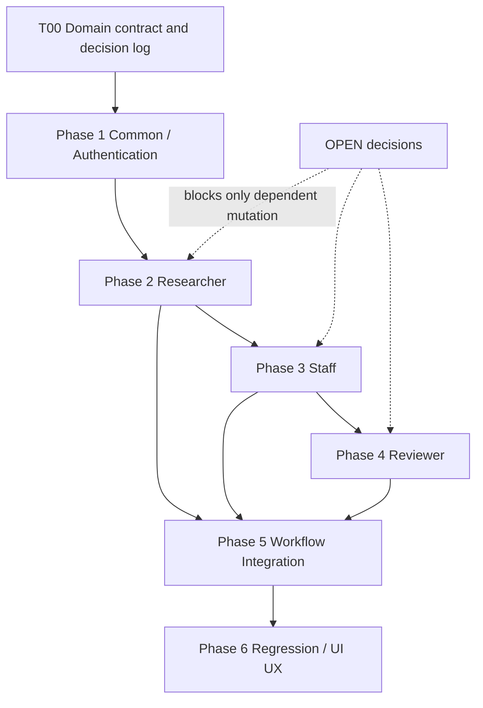

# Demo Revision Plan — แผนให้พิจารณาก่อนพัฒนา

วันที่ 14 November 2026. **Planning only: ยังไม่เริ่มimplementation ไม่แก้Source Code/UI/API/Database และไม่สร้าง/ลบหน้าจอจริง**. ใช้Proposed IDsจาก05และGap IDsจาก04เพื่อสั่งงานเป็นหน้า. Phase ไม่ใช่การอนุมัติSeminarMVP;ต้องเลือกscopeก่อนตามOPEN-12

## หลักการส่งมอบ

แต่ละงานต้องระบุPage ID,FR/BR/AC/TR,sourceที่เกี่ยวข้อง,decisionOPEN,dependency,ขอบเขตไฟล์และregressionก่อนเริ่ม. อ่านRequirementsชุดที่ผู้ใช้ยืนยันใน C:/Users/User/Downloads/เอกสารความต้องการ/ ไม่ใช้AGENTSpathเก่าที่เปิดไม่ได้. คำสั่งพัฒนาภายหลังต้องชัดว่าlocalDemoหรือFirebaseด้วย;ไม่ใช้Mockแทนserversecurityโดยเงียบ

กำหนดคำว่า Done: behaviorตรงACที่ยืนยันแล้ว,inputs/role/state/serverguardsเมื่อเกี่ยวข้อง,non-transitionactionsคงstate,documentversions/auditครบ,testsผ่าน,ไม่มีunrelatedregressionและไม่มีข้อOPENถูกตัดสินเอง. ถ้าติดOPENให้ส่งส่วนread-only/designที่ไม่ขึ้นต่อคำตอบ และระบุส่วนPENDING

## Dependency และงานตั้งต้น T00

**T00 — Domain & traceability contract (P0, ภายใต้Phase1 ก่อนเปลี่ยนหน้าที่mutate)**

1. เลือกMVPและmodeกับผู้ใช้;สร้างcapabilitymatrix3 rolesตามFR,แยกpermissionsที่OPEN. ยืนยันตำแหน่งเอกสารในAGENTSเมื่อได้รับมอบหมายupdatecontext
2. กำหนด9StateIDsและ17 TRจากเอกสาร;actionnames+payload+requiredrole+fromstate+guard+audit+documentversion+idempotency. Draftของแบบประเมิน/closuretaskเป็นrecordstatusไม่เพิ่มprojectmainstate
3. กำหนดsubmissionbundle kinds: source RS1, generated readyversion, signed RS1, affiliationevidence, researchstandardsevidence, reportdraft/revised, publication/summaryreport, evaluationfeedback;ชนิดไฟล์/fieldsที่OPENยังไม่ตรึงเป็นapprovedpolicy
4. วางcommonreadmodel/ACLredactionทั้งcurrentevaluationsและarchives/submissions/files/registry. กำหนดreleaseimmutableeventและnewreportversionlink ไม่resetreviewround
5. เขียนconformancetestplanก่อนimplementation;ไม่ลบtestเดิมเพียงเพื่อให้ผ่าน. แยกlegacybehaviorที่ตั้งใจเลิกออกจากvalidregression
6. วางmigrationdry-runสำหรับfixtures/localstorage/servercopies;preserveoriginal+audit;ไม่applymigrationหรือseedproductionในงานplanning

Phases2–4ออกแบบและทดสอบpageด้วยcontractfixturesได้ แต่ยังไม่claimend-to-endเสร็จจนPhase5. เช่นN-R08ต้องใช้releaseeventจากN-S08ที่พัฒนาทีหลัง;Phase2ทำUI/contractfixtureก่อน แล้วintegratePhase5 ไม่ปลอมผลว่าbackendทำแล้ว

## Phase 1: Common & Authentication

ทำT00ก่อน แล้วCommon shell/Auth/Files/ACL. SharedHistory/Notificationเป็นP1แต่contractต้องมีตั้งแต่ต้น;ไม่จำเป็นต้องรอUIตกแต่งครบก่อนทำP0ถัดไป

| Task / Page | Priority / Action | ต้องแก้หรือเพิ่ม | Dependencies / OPEN | Validation ก่อนส่งมอบ |
|---|---|---|---|---|
| T-N-C01 / Demo Scenario Entry | P2 / REDESIGN | 3rolepersona; v1.6scenariofixtures; clearmocklabels; resetlocalonly; Actions: Select persona/scenario; resetwithconfirm; Components: RoleCards,ScenarioCatalog,DemoNotice | T00 | เข้าroleถูก;resetเฉพาะfixture;ไม่แสดงreal-loginclaim |
| T-N-C02 / Sign In | P0 / MODIFY | email/password; restoreprofile; pending/error/denied; signout; Actions: Sign in/out; Components: AuthForm,SessionGate,AccessError | T00 | disabledprofile/wrongroleURL/expiredsessionถูกปฏิเสธ;ไม่มีlocalfallbackเงียบ |
| T-N-C03 / Not Found / Access Denied | P1 / MODIFY | 404/403/projectmissing/loading/retryแยกข้อความเหมาะสม; Actions: Back; retryauthorizedread; Components: ErrorState,EmptyState,RetryAction | N-C02 | deep-linkinvalid/forbiddenไม่renderข้อมูลหรือฟอร์มอื่น |
| T-N-X01 / Project Overview | P0 / MERGE | 9statebadge; nextaction; keydates; information/research/budget; terminalread-onlysummary; changes/cancellationresult; Actions: Opendocuments/history; editeligibleproposal; stafftasklinks; Components: ProjectShell,StateBadge,NextAction,ProjectFacts,RoleActionBar | T00,N-C02 | 9 statesแสดงถูก;terminalไม่มีedit/closureของcancelled;roleactionถูก |
| T-N-X02 / Project Document Library / Report Reader | P0 / REDESIGN | filterkind/version; PDFpreview/download; source/signed/affiliation/report/publicationfiles; reviewerassignedreportonly; Actions: Select/open/download; Components: DocumentList,VersionSelector,PDFReader,AccessGate | T00,N-C02,N-X01 | เปิดไฟล์ตรงversion+bytes;missingfileไม่fabricate;unauthorizedURLdenied;viewไม่เปลี่ยนstate |
| T-N-X03 / Project Activity & History | P1 / MERGE | statebranchhistory; actor/time/reason; documentversions; externalresults; before/after; cancellation; releaseevent; Actions: Filter/page; authorizedfilelink; Components: ActivityTimeline,EventFilters,ChangeDiff | T00,N-X01 | eventchronology/actor/previous-newถูก;publicationไม่แสดงว่าผ่านevaluation;ไม่มีผลผู้อื่นรั่ว |
| T-N-X04 / Notifications & Tasks | P1 / MODIFY | unread; relatedtask; deadlinesตามconfirmeddate; loading/error; emaildeliverylabelเฉพาะเมื่อมีsenderจริง; Actions: Readall; opentask; paginate; Components: NotificationList,TaskLink,DeadlineSummary | T00,N-C02 | readmarksaccountscoped;ไม่เห็นothers;extensiondateสะท้อนใหม่;ไม่มีfakeemailstatus |

### Work order: N-C01

- Source scope: C01; DemoScenarios. เมื่อเริ่มจริงให้ค้นsourceของExistingIDจาก02;เสนอไฟล์ใหม่ตามpageนี้ได้แต่ไม่รวมหน้าหรือserviceอื่นที่ไม่จำเป็น
- Change objective: เริ่มสาธิตโดยแยกจากระบบบัญชี; เป็นsimulationไม่ใช่Auth;ไม่แก้realrecords
- Traceability: NFR-10; FR-COM-01 (demoexceptionต้องlabel); ไม่มี; ตรวจACในแถวFRและStateAC-TRตามที่มี ไม่สร้างRequirementIDใหม่
- Deliverable: page/component/actioncontractตาม05 + testsที่ตรวจbehaviorด้านบน + รายงานchangedfiles/results/openlimitations. ยังไม่อนุญาตdeploy/productiondataจากworkorderตัวอย่างนี้

### Work order: N-C02

- Source scope: C02. เมื่อเริ่มจริงให้ค้นsourceของExistingIDจาก02;เสนอไฟล์ใหม่ตามpageนี้ได้แต่ไม่รวมหน้าหรือserviceอื่นที่ไม่จำเป็น
- Change objective: เข้าสู่บัญชีที่มีสิทธิ์; roleจากserverprofile;3roleเท่านั้น;ไม่เพิ่มregistration/adminroleนอกscope
- Traceability: FR-COM-01/02; NFR-01/02; ไม่มี; ตรวจACในแถวFRและStateAC-TRตามที่มี ไม่สร้างRequirementIDใหม่
- Deliverable: page/component/actioncontractตาม05 + testsที่ตรวจbehaviorด้านบน + รายงานchangedfiles/results/openlimitations. ยังไม่อนุญาตdeploy/productiondataจากworkorderตัวอย่างนี้

### Work order: N-C03

- Source scope: C03; App error branches. เมื่อเริ่มจริงให้ค้นsourceของExistingIDจาก02;เสนอไฟล์ใหม่ตามpageนี้ได้แต่ไม่รวมหน้าหรือserviceอื่นที่ไม่จำเป็น
- Change objective: สื่อสารerrors/emptyโดยไม่เปิดข้อมูล; ไม่เปิดเผยชื่อโครงการที่ไม่มีสิทธิ์;routeparse+capabilityguard
- Traceability: FR-COM-02/04; NFR-08; ไม่มี; ตรวจACในแถวFRและStateAC-TRตามที่มี ไม่สร้างRequirementIDใหม่
- Deliverable: page/component/actioncontractตาม05 + testsที่ตรวจbehaviorด้านบน + รายงานchangedfiles/results/openlimitations. ยังไม่อนุญาตdeploy/productiondataจากworkorderตัวอย่างนี้

### Work order: N-X01

- Source scope: R07/S03/V03; legacyActiveProjectDetail. เมื่อเริ่มจริงให้ค้นsourceของExistingIDจาก02;เสนอไฟล์ใหม่ตามpageนี้ได้แต่ไม่รวมหน้าหรือserviceอื่นที่ไม่จำเป็น
- Change objective: จุดเริ่มงานโครงการตามสิทธิ์; reviewerเห็นเฉพาะnecessaryassignmentcontext;CLOSED/CANCELLEDแยก;ไม่มีgenericstatusdropdown
- Traceability: FR-COM-04; FR-RES-18/20; FR-CLS-12; FR-REG-03; แสดงTRทั้งหมด;ไม่triggerด้วยการอ่าน; ตรวจACในแถวFRและStateAC-TRตามที่มี ไม่สร้างRequirementIDใหม่
- Deliverable: page/component/actioncontractตาม05 + testsที่ตรวจbehaviorด้านบน + รายงานchangedfiles/results/openlimitations. ยังไม่อนุญาตdeploy/productiondataจากworkorderตัวอย่างนี้

### Work order: N-X02

- Source scope: R09/S05/V05; ProjectDocuments/ResearchDocuments. เมื่อเริ่มจริงให้ค้นsourceของExistingIDจาก02;เสนอไฟล์ใหม่ตามpageนี้ได้แต่ไม่รวมหน้าหรือserviceอื่นที่ไม่จำเป็น
- Change objective: อ่านไฟล์จริงและเลือกเวอร์ชัน; noinventedreadablecontent;PDFactionไม่เปลี่ยนstate;reviewerไม่เห็นothersfeedback;postCLOSEDPDFpolicyPENDING
- Traceability: FR-RES-08/10; FR-SIG-06; FR-ADM-02; FR-REV-03/07; NFR-02/05; ไม่มี;ประกอบTR-05/11–16; ตรวจACในแถวFRและStateAC-TRตามที่มี ไม่สร้างRequirementIDใหม่
- Deliverable: page/component/actioncontractตาม05 + testsที่ตรวจbehaviorด้านบน + รายงานchangedfiles/results/openlimitations. ยังไม่อนุญาตdeploy/productiondataจากworkorderตัวอย่างนี้

### Work order: N-X03

- Source scope: R08/S04/V04; historyหลายcomponent. เมื่อเริ่มจริงให้ค้นsourceของExistingIDจาก02;เสนอไฟล์ใหม่ตามpageนี้ได้แต่ไม่รวมหน้าหรือserviceอื่นที่ไม่จำเป็น
- Change objective: ตรวจสอบย้อนหลังในที่เดียว; append-only;redactnestedarchives;timelineไม่บังคับทุกโครงการผ่านreportpath
- Traceability: FR-COM-05; FR-RES-19; FR-ADM-10; FR-CLS-11; NFR-03; อ่านTR-01–17; ตรวจACในแถวFRและStateAC-TRตามที่มี ไม่สร้างRequirementIDใหม่
- Deliverable: page/component/actioncontractตาม05 + testsที่ตรวจbehaviorด้านบน + รายงานchangedfiles/results/openlimitations. ยังไม่อนุญาตdeploy/productiondataจากworkorderตัวอย่างนี้

### Work order: N-X04

- Source scope: R13/S12/V09. เมื่อเริ่มจริงให้ค้นsourceของExistingIDจาก02;เสนอไฟล์ใหม่ตามpageนี้ได้แต่ไม่รวมหน้าหรือserviceอื่นที่ไม่จำเป็น
- Change objective: รวมกิจกรรมและงานตามสิทธิ์; noemailsentclaim;cadenceOPEN-10;ไม่ใช้การรับอีเมลเป็นprerequisite
- Traceability: FR-COM-05; FR-RES-19/20; UseCase3.8; NFR-03; ไม่มี;eventlinksไปTRที่เกี่ยวข้อง; ตรวจACในแถวFRและStateAC-TRตามที่มี ไม่สร้างRequirementIDใหม่
- Deliverable: page/component/actioncontractตาม05 + testsที่ตรวจbehaviorด้านบน + รายงานchangedfiles/results/openlimitations. ยังไม่อนุญาตdeploy/productiondataจากworkorderตัวอย่างนี้

## Phase 2: Researcher

ลำดับแนะนำ: MyProjects/Editor → Import → Ready/PDF → SignedSubmit → ClosureSubmit → ReleasedResults/RevisedReport;Dashboardตามreadmodel. ติดOPEN-04เฉพาะConfirmReadyไม่หยุดdraft/editor/fileviewer

| Task / Page | Priority / Action | ต้องแก้หรือเพิ่ม | Dependencies / OPEN | Validation ก่อนส่งมอบ |
|---|---|---|---|---|
| T-N-R01 / Researcher Dashboard | P1 / MODIFY | countsตาม9 states; pendingactions; recent; newproposal; deadlines; Actions: Openlist/task; newproposal; Components: SummaryCards,RecentProjects,TaskSummary | N-X01,T00 | countsตรงlist;cancelledไม่active;tasklinkตามstate |
| T-N-R02 / My Projects | P0 / MERGE | search/status/pagination; terminalfilters; taskfilter; demoexamplesเป็นsecondaryview; Actions: Search/clear/open/new; Components: ProjectList,Filters,Pagination | N-X01,T00 | search+refresh+backรักษาfilters;ไม่เห็นโครงการอื่น |
| T-N-R03 / RS-1 Proposal Editor | P0 / REDESIGN | manualform; reviewimportedvalues; save; fieldvalidation; structuredsignatories; budget; draftrecovery; Actions: Edit/save; openPDFready; resubmitcorrectionเมื่อtaskอนุญาต; Components: RS1Sections,ValidationSummary,SignatoryList,DraftControls | T00,N-X02; D01/D06เฉพาะfieldsที่ยังไม่ยืนยัน | save/reopenค่าตรง;unauthorizededitdenied;revisionคงSTAFF_REVIEW;ไม่เสียworkingdraft |
| T-N-R04 / RS-1 Import & Extraction Review | P1 / MODIFY | filevalidation; sourceversion; found/missing; editablemapping; explicitconfirm; clearvaluehandling; Actions: Upload/change; correct/clear; confirmtoform; Components: UploadDropzone,SourcePreview,ExtractedFields,MappingErrors | N-R03,N-X02; D01 | badfileไม่ทำลายdraft;blankclearsintendedvalue;sourceprovenanceครบ;importไม่ส่งproposal |
| T-N-R05 / Proposal PDF & Affiliation Preparation | P0 / SPLIT | preview/download; versionfreeze; completeness; signaturetemplate; readyconfirmation; Actions: Generate/preview/download; Confirmready; Components: ProposalPDFPreview,VersionSummary,ReadyConfirmation | N-R03,N-X02; D02ก่อนenableconfirm | PDFตรงversion;preview/downloadสถานะเดิม;readytransitionเฉพาะtriggerที่ผู้ใช้ยืนยัน |
| T-N-R06 / Signed Proposal Submission | P0 / REDESIGN | signedfile+affiliationmeetingORconfirmation; signatorychecklist; consentconditional; receipt/idempotency; Actions: Attach/replace; confirmsignatures/consent; submit; Components: EvidenceChecklist,FileUploader,ConsentAttestation,SubmitReview | N-R05,N-X02,T00; D08เฉพาะfilepolicy | missingeachfile/consentปฏิเสธ;uploadstateunchanged;confirm→STAFF_REVIEWครั้งเดียว;staffอ่านbundleเดียวกัน |
| T-N-R07 / Closure Submission | P0 / SPLIT | choosepath; report5chapterdraft OR summaryreport+publicationevidence; supportfiles; draft/confirm; extra-documentreply; Actions: Save/attach/remove/confirm; answerrequest; Components: ClosurePathSelector,DocumentChecklist,UploadList,SubmissionReview | T00,N-X02,N-R02; D07 | pathfilesครบก่อนconfirm;save/uploadไม่transition;return/addคงCLOSURE_REVIEW |
| T-N-R08 / Revised Final Report Submission | P0 / SPLIT | releasedfeedbacklink; newversionupload; instructions; receipt; additionaldocs; Actions: Openresults; upload/submitrevision; Components: ReleasedFeedbackSummary,VersionedUpload,RevisionChecklist | T00,N-X02,N-R09; finalintegrationหลังN-S08 | releaseแล้วแก้และส่งได้;newfileversionจริง;assignments/evaluationsเดิมไม่reset;ยังREPORT_EVALUATION |
| T-N-R09 / Released Evaluation Results | P0 / MODIFY | 3individualsubmittedresults; releaseactor/time; individualPDFondemand; instructions; Actions: Read; downloadauthorizedPDF; goRevision; Components: EvaluationReadOnly,ReleaseBanner,PDFAction | T00,N-X01; finalintegrationN-S08; PDFserviceN-V05 | directURL/APIbefore-releasedenied;3ผลตรงsubmitted;PDFstateunchanged |

### Work order: N-R01

- Source scope: R01; legacyDashboard. เมื่อเริ่มจริงให้ค้นsourceของExistingIDจาก02;เสนอไฟล์ใหม่ตามpageนี้ได้แต่ไม่รวมหน้าหรือserviceอื่นที่ไม่จำเป็น
- Change objective: เห็นงานตนและสิ่งที่ต้องทำก่อน; owneronly;layoutเป็นdesignproposalไม่เพิ่มbusinessrule
- Traceability: FR-COM-03/04; FR-RES-18/20; ไม่มี; ตรวจACในแถวFRและStateAC-TRตามที่มี ไม่สร้างRequirementIDใหม่
- Deliverable: page/component/actioncontractตาม05 + testsที่ตรวจbehaviorด้านบน + รายงานchangedfiles/results/openlimitations. ยังไม่อนุญาตdeploy/productiondataจากworkorderตัวอย่างนี้

### Work order: N-R02

- Source scope: R02; MyProjects legacy. เมื่อเริ่มจริงให้ค้นsourceของExistingIDจาก02;เสนอไฟล์ใหม่ตามpageนี้ได้แต่ไม่รวมหน้าหรือserviceอื่นที่ไม่จำเป็น
- Change objective: ค้นโครงการของตน; owneronly;สถานะเลือกจาก9StateID
- Traceability: FR-COM-03; FR-RES-18/19; ไม่มี; ตรวจACในแถวFRและStateAC-TRตามที่มี ไม่สร้างRequirementIDใหม่
- Deliverable: page/component/actioncontractตาม05 + testsที่ตรวจbehaviorด้านบน + รายงานchangedfiles/results/openlimitations. ยังไม่อนุญาตdeploy/productiondataจากworkorderตัวอย่างนี้

### Work order: N-R03

- Source scope: R03/R05; ManualEntry. เมื่อเริ่มจริงให้ค้นsourceของExistingIDจาก02;เสนอไฟล์ใหม่ตามpageนี้ได้แต่ไม่รวมหน้าหรือserviceอื่นที่ไม่จำเป็น
- Change objective: กรอก/แก้ร่างและrevisionที่อนุญาต; ไม่แสดงWebapprovalหลังรับรอง;requiredfieldsOPEN-01/06/13;saveไม่transitionนอกจากinitialDRAFT
- Traceability: FR-RES-01–03/06–09/12/16/17; FR-SIG-01; TR-01/02/04/06; TR-07 PENDING; ตรวจACในแถวFRและStateAC-TRตามที่มี ไม่สร้างRequirementIDใหม่
- Deliverable: page/component/actioncontractตาม05 + testsที่ตรวจbehaviorด้านบน + รายงานchangedfiles/results/openlimitations. ยังไม่อนุญาตdeploy/productiondataจากworkorderตัวอย่างนี้

### Work order: N-R04

- Source scope: R04. เมื่อเริ่มจริงให้ค้นsourceของExistingIDจาก02;เสนอไฟล์ใหม่ตามpageนี้ได้แต่ไม่รวมหน้าหรือserviceอื่นที่ไม่จำเป็น
- Change objective: ตรวจแก้ข้อมูลที่สกัดก่อนนำเข้าร่าง; ไม่สร้างค่าที่ไม่พบ;noOCRrequirementจนยืนยัน;types/accuracyOPEN
- Traceability: FR-RES-04–08; NFR-06/07; OPEN-01–03; TR-02; ตรวจACในแถวFRและStateAC-TRตามที่มี ไม่สร้างRequirementIDใหม่
- Deliverable: page/component/actioncontractตาม05 + testsที่ตรวจbehaviorด้านบน + รายงานchangedfiles/results/openlimitations. ยังไม่อนุญาตdeploy/productiondataจากworkorderตัวอย่างนี้

### Work order: N-R05

- Source scope: R05/R06 ProposalPDF. เมื่อเริ่มจริงให้ค้นsourceของExistingIDจาก02;เสนอไฟล์ใหม่ตามpageนี้ได้แต่ไม่รวมหน้าหรือserviceอื่นที่ไม่จำเป็น
- Change objective: แยกดูPDFกับยืนยันฉบับพร้อมยื่น; TR03triggerOPEN-04;การสร้าง/โหลดPDFลำพังไม่เปลี่ยนstate;externaldeliveryไม่อ้างreceived
- Traceability: FR-RES-09–12; FR-SIG-01; NFR-05; TR-03 (PENDINGtrigger), TR-04; ตรวจACในแถวFRและStateAC-TRตามที่มี ไม่สร้างRequirementIDใหม่
- Deliverable: page/component/actioncontractตาม05 + testsที่ตรวจbehaviorด้านบน + รายงานchangedfiles/results/openlimitations. ยังไม่อนุญาตdeploy/productiondataจากworkorderตัวอย่างนี้

### Work order: N-R06

- Source scope: R06. เมื่อเริ่มจริงให้ค้นsourceของExistingIDจาก02;เสนอไฟล์ใหม่ตามpageนี้ได้แต่ไม่รวมหน้าหรือserviceอื่นที่ไม่จำเป็น
- Change objective: ตรวจbundleก่อนส่งให้staff; FR-SIGtypes/proofOPEN-15/16;ไม่ตรวจลายเซ็นแท้เอง;servergateทั้งbundle
- Traceability: FR-RES-13–17; FR-SIG-02–06; BR-03/04/11/12; TR-05; TR-06ส่งใหม่ตามtask; ตรวจACในแถวFRและStateAC-TRตามที่มี ไม่สร้างRequirementIDใหม่
- Deliverable: page/component/actioncontractตาม05 + testsที่ตรวจbehaviorด้านบน + รายงานchangedfiles/results/openlimitations. ยังไม่อนุญาตdeploy/productiondataจากworkorderตัวอย่างนี้

### Work order: N-R07

- Source scope: R11 ResearcherForm. เมื่อเริ่มจริงให้ค้นsourceของExistingIDจาก02;เสนอไฟล์ใหม่ตามpageนี้ได้แต่ไม่รวมหน้าหรือserviceอื่นที่ไม่จำเป็น
- Change objective: ยื่นปิดสองเส้นทาง; publicationnoreviewer;CANCELLEDไม่เข้า;criteriaOPEN-14;ไม่แทนeOfficeหนังสือ
- Traceability: FR-CLS-01–06; BR-07; TR-11/12; ตรวจACในแถวFRและStateAC-TRตามที่มี ไม่สร้างRequirementIDใหม่
- Deliverable: page/component/actioncontractตาม05 + testsที่ตรวจbehaviorด้านบน + รายงานchangedfiles/results/openlimitations. ยังไม่อนุญาตdeploy/productiondataจากworkorderตัวอย่างนี้

### Work order: N-R08

- Source scope: R11 post-evaluationbranch. เมื่อเริ่มจริงให้ค้นsourceของExistingIDจาก02;เสนอไฟล์ใหม่ตามpageนี้ได้แต่ไม่รวมหน้าหรือserviceอื่นที่ไม่จำเป็น
- Change objective: ส่งฉบับแก้ไขหลังstaffrelease; ไม่เปิดก่อนrelease;ไม่ส่งReviewerอีกรอบ;reportversionแยกreviewround
- Traceability: FR-CLS-09; FR-REV-08/10; TR-15 self;ไม่TR-16เอง; ตรวจACในแถวFRและStateAC-TRตามที่มี ไม่สร้างRequirementIDใหม่
- Deliverable: page/component/actioncontractตาม05 + testsที่ตรวจbehaviorด้านบน + รายงานchangedfiles/results/openlimitations. ยังไม่อนุญาตdeploy/productiondataจากworkorderตัวอย่างนี้

### Work order: N-R09

- Source scope: R12. เมื่อเริ่มจริงให้ค้นsourceของExistingIDจาก02;เสนอไฟล์ใหม่ตามpageนี้ได้แต่ไม่รวมหน้าหรือserviceอื่นที่ไม่จำเป็น
- Change objective: อ่านผลที่staffเปิดเผยแล้ว; ก่อนreleaseไม่มีdata;combinedPDF/retention/postCLOSEDpending;ไม่รวมผลเป็นautodecision
- Traceability: FR-REV-07/10; FR-CLS-09; NFR-05; TR-15 context;PDFnone; ตรวจACในแถวFRและStateAC-TRตามที่มี ไม่สร้างRequirementIDใหม่
- Deliverable: page/component/actioncontractตาม05 + testsที่ตรวจbehaviorด้านบน + รายงานchangedfiles/results/openlimitations. ยังไม่อนุญาตdeploy/productiondataจากworkorderตัวอย่างนี้

## Phase 3: Research Administration Staff

ลำดับแนะนำ: Registry/ProposalReview → Acknowledgement → ExternalChanges → ClosureReview → Assign3 → TrackingRelease → FinalVerification;CancellationUIเป็นPENDINGจนOPEN-20ตอบ. ไม่มีWebapprovalให้Researcherแก้ข้อมูลรับรองเอง

| Task / Page | Priority / Action | ต้องแก้หรือเพิ่ม | Dependencies / OPEN | Validation ก่อนส่งมอบ |
|---|---|---|---|---|
| T-N-S01 / Staff Dashboard | P1 / REDESIGN | proposal/acknowledgement/closure/evaluation/finalqueues; deadlines; recent; cancelledsummary; Actions: Openfilteredqueue/project; Components: QueueCards,RecentProjects,WorkSummary | T00,N-S02 | countsตรงstates/tasks;0/3–3/3แยกจากmainstate |
| T-N-S02 / Project Registry & Work Queues | P0 / MERGE | search/status/task/roundview; allowedregistryfields; pendingmappinglabels; archiveview; Actions: Search/open; exportเฉพาะถ้าภายหลังมอบหมายไม่รวมMVP; Components: ProjectTable,QueueFilters,RegistryColumns | T00,N-X01; D10/D11/D04เฉพาะunconfirmedfields | ทุกqueueเข้าprojecttaskถูก;ไม่มีunrestrictedstatusdropdown;registrypendingไม่mutatepolicy |
| T-N-S03 / Proposal Review | P0 / MODIFY | structuredproposal+budget+signed/evidence/consentversion; reasonedrevision; reviewhistory; Actions: Openfiles; requestcorrection; recordpassed; Components: ProposalSummary,EvidencePanel,ReviewChecklist,DecisionForm | N-R06,N-X02,T00; D01/D03สำหรับOPENparts | returnreasonrequired;researchertaskcreated;resubmitselfloop;pass→COMMITTEE_ACKNOWLEDGEMENT |
| T-N-S04 / Committee Acknowledgement & Certification Record | P0 / SPLIT | externalreference; meetingrecord; standardsmetadata/evidence; certificationevent; Actions: Recordexternalacknowledgement; certify; Components: ExternalReferenceForm,AcknowledgementRecord,StandardsPanel | N-S03,N-X02; D09ก่อนบังคับstandardsrule | เฉพาะstateถูก+staff;ackwording;certifyevent→IN_PROGRESS;ไม่blockทุกprojectเอง |
| T-N-S05 / External Change & Extension Results | P0 / MERGE | approved/deniedresult; letter/evidence; allowedfields; before/after; extensioncount/duration/history; Actions: Recordoutcome; applyapprovedchange; viewhistory; Components: ExternalResultForm,ChangeDiff,ExtensionHistory,FileUploader | T00,N-X02; D05/D06เฉพาะedgecases | deniedไม่แก้data;approvedstaffonly;third/>6monthdenied;stateเดิม;actor/oldnewครบ |
| T-N-S06 / Closure Document Review | P0 / SPLIT | pathchecklist; missingrequests; publicationevidence; reporthandoff; Actions: Requestmore; completepublicationclose; openassignment; Components: ClosureDocuments,PathChecklist,ReturnForm | N-R07,N-X02; D07 | publicationthroughstaffonlyclose;reportต้องassignment3;missingremainCLOSURE_REVIEW |
| T-N-S07 / Assign Three Expert Reviewers | P0 / SPLIT | activeauthorizeddirectory; exactly3distinct; assignedreport; dueDateasdesign; summaryconfirm; Actions: Pick3; confirmassignment; Components: ReviewerPicker,AssignmentSummary,ReportVersion | N-S06,N-X02,T00 | 0/1/2/4/duplicate/invalidreviewerblocked;3valid→REPORT_EVALUATION;onlyassignedread |
| T-N-S08 / Evaluation Tracking & Release | P0 / REDESIGN | 3statusrows; submittedread-onlyanswers; individualPDF; releaseconfirmation/actor/time; Actions: Readsubmitted; generatePDF; confirmrelease; Components: ReviewerProgress,EvaluationReadOnly,ReleaseForm,PDFAction | N-S07,T00; finalintegrationN-V03/04; PDFN-V05 | 0/3–2/3releaseblocked;3/3once;before-releaseRdenied;releaseactor/timeimmutable |
| T-N-S09 / Final Report Verification & Closure | P0 / SPLIT | released3results; revisedfileversion; completeness; returnadditionalfiles; closeconfirm; closureletterrecord; Actions: Requestdocs; verify; close; recordexternalnotice; Components: FinalChecklist,VersionComparison,CloseConfirmation,ExternalNoticeRecord | N-R08,N-S08,N-X02 | no-newfilecannotclose;missingreturnstaysREPORT_EVALUATION;onceverified→CLOSED;postclosenoticeaccessibleตามสิทธิ์ |
| T-N-S10 / Cancellation Record | P0 / PENDING | reasonenum;OTHERdetail;supportfiles;previousstate;confirm;readonlyreceipt; Actions: Selectreason; attach; confirmเมื่อสิทธิ์ยืนยันแล้ว; Components: CancellationForm,ReasonSelector,AuditSummary | T00,N-X02; D12ก่อนenablemutation | noReason/OTHERempty/unauthorized/CLOSEDdenied;valid→CANCELLEDauditครบ;cannotenterclosure |

### Work order: N-S01

- Source scope: S01; legacyStaffDashboard. เมื่อเริ่มจริงให้ค้นsourceของExistingIDจาก02;เสนอไฟล์ใหม่ตามpageนี้ได้แต่ไม่รวมหน้าหรือserviceอื่นที่ไม่จำเป็น
- Change objective: จัดลำดับคิวstaff; workspace+staffscopeตามสิทธิ์;ไม่assigncancelpermissionเอง
- Traceability: FR-ADM-01/08; FR-COM-03/04; ไม่มี; ตรวจACในแถวFRและStateAC-TRตามที่มี ไม่สร้างRequirementIDใหม่
- Deliverable: page/component/actioncontractตาม05 + testsที่ตรวจbehaviorด้านบน + รายงานchangedfiles/results/openlimitations. ยังไม่อนุญาตdeploy/productiondataจากworkorderตัวอย่างนี้

### Work order: N-S02

- Source scope: S02 + threequeuevariants; legacyStaffRegistry. เมื่อเริ่มจริงให้ค้นsourceของExistingIDจาก02;เสนอไฟล์ใหม่ตามpageนี้ได้แต่ไม่รวมหน้าหรือserviceอื่นที่ไม่จำเป็น
- Change objective: รวมรายการ/ทะเบียน/คิวโดยไม่ซ้ำหลายหน้า; registryExcelmappingOPEN-21;noharddelete/noautomatedenrollmentblock;scopeworkspace
- Traceability: FR-ADM-01/08; FR-REG-01–04; BR-01/16; ไม่มี; ตรวจACในแถวFRและStateAC-TRตามที่มี ไม่สร้างRequirementIDใหม่
- Deliverable: page/component/actioncontractตาม05 + testsที่ตรวจbehaviorด้านบน + รายงานchangedfiles/results/openlimitations. ยังไม่อนุญาตdeploy/productiondataจากworkorderตัวอย่างนี้

### Work order: N-S03

- Source scope: S06. เมื่อเริ่มจริงให้ค้นsourceของExistingIDจาก02;เสนอไฟล์ใหม่ตามpageนี้ได้แต่ไม่รวมหน้าหรือserviceอื่นที่ไม่จำเป็น
- Change objective: ตรวจsubmissionbundleและแจ้งแก้/ผ่าน; requiredchecklistOPEN-06;returnไม่เพิ่มmainstate;ไม่committeeapprove
- Traceability: FR-ADM-01–05/12; FR-SIG-06; FR-RES-16/17; TR-06/08; TR-07 PENDING; ตรวจACในแถวFRและStateAC-TRตามที่มี ไม่สร้างRequirementIDใหม่
- Deliverable: page/component/actioncontractตาม05 + testsที่ตรวจbehaviorด้านบน + รายงานchangedfiles/results/openlimitations. ยังไม่อนุญาตdeploy/productiondataจากworkorderตัวอย่างนี้

### Work order: N-S04

- Source scope: S07 committee/activebranch. เมื่อเริ่มจริงให้ค้นsourceของExistingIDจาก02;เสนอไฟล์ใหม่ตามpageนี้ได้แต่ไม่รวมหน้าหรือserviceอื่นที่ไม่จำเป็น
- Change objective: บันทึกขั้นตอนภายนอกเพื่อทราบและรับรอง; ไม่มีcommitteeaccount/approval;ไม่เพิ่มeOfficePendingstate;standardswarn/blockOPEN-17
- Traceability: FR-ADM-06/07/11/12; FR-STD-01–03; BR-05/06/13; TR-09; ตรวจACในแถวFRและStateAC-TRตามที่มี ไม่สร้างRequirementIDใหม่
- Deliverable: page/component/actioncontractตาม05 + testsที่ตรวจbehaviorด้านบน + รายงานchangedfiles/results/openlimitations. ยังไม่อนุญาตdeploy/productiondataจากworkorderตัวอย่างนี้

### Work order: N-S05

- Source scope: S08 + S09/R10oldcorrection. เมื่อเริ่มจริงให้ค้นsourceของExistingIDจาก02;เสนอไฟล์ใหม่ตามpageนี้ได้แต่ไม่รวมหน้าหรือserviceอื่นที่ไม่จำเป็น
- Change objective: บันทึกผลeOfficeและแก้เฉพาะapproveddata; onlyIN_PROGRESS;researcherreadonly;eOfficenoAPI;≤2extensions≤6monthseach;calendar/exceptionrulesยังต้องยืนยัน
- Traceability: FR-ADM-09/13; BR-06/14; OPEN-10/13; TR-10 self; approveddatachangeself; ตรวจACในแถวFRและStateAC-TRตามที่มี ไม่สร้างRequirementIDใหม่
- Deliverable: page/component/actioncontractตาม05 + testsที่ตรวจbehaviorด้านบน + รายงานchangedfiles/results/openlimitations. ยังไม่อนุญาตdeploy/productiondataจากworkorderตัวอย่างนี้

### Work order: N-S06

- Source scope: S10 StaffForm check/publicationbranch. เมื่อเริ่มจริงให้ค้นsourceของExistingIDจาก02;เสนอไฟล์ใหม่ตามpageนี้ได้แต่ไม่รวมหน้าหรือserviceอื่นที่ไม่จำเป็น
- Change objective: ตรวจเอกสารตามpathก่อนส่งประเมินหรือปิด; publicationnoReviewer;closureuploadไม่close;criterionOPEN-14
- Traceability: FR-CLS-05–08/11; BR-07/09; TR-12/13/14; ตรวจACในแถวFRและStateAC-TRตามที่มี ไม่สร้างRequirementIDใหม่
- Deliverable: page/component/actioncontractตาม05 + testsที่ตรวจbehaviorด้านบน + รายงานchangedfiles/results/openlimitations. ยังไม่อนุญาตdeploy/productiondataจากworkorderตัวอย่างนี้

### Work order: N-S07

- Source scope: S10 embeddedassignment. เมื่อเริ่มจริงให้ค้นsourceของExistingIDจาก02;เสนอไฟล์ใหม่ตามpageนี้ได้แต่ไม่รวมหน้าหรือserviceอื่นที่ไม่จำเป็น
- Change objective: มอบหมาย3คนพร้อมreportversion; ไม่มีselfappoint;ไม่แปลงproposedreviewerในRS1เป็นauthassignmentอัตโนมัติ;formalappointmentexternal
- Traceability: FR-REV-01/03; FR-CLS-07; TR-13; ตรวจACในแถวFRและStateAC-TRตามที่มี ไม่สร้างRequirementIDใหม่
- Deliverable: page/component/actioncontractตาม05 + testsที่ตรวจbehaviorด้านบน + รายงานchangedfiles/results/openlimitations. ยังไม่อนุญาตdeploy/productiondataจากworkorderตัวอย่างนี้

### Work order: N-S08

- Source scope: S11 + S10FinalVerification + legacyAdvisorShowcase. เมื่อเริ่มจริงให้ค้นsourceของExistingIDจาก02;เสนอไฟล์ใหม่ตามpageนี้ได้แต่ไม่รวมหน้าหรือserviceอื่นที่ไม่จำเป็น
- Change objective: ติดตามผล0/3–3/3และเปิดเผยครั้งเดียว; draftไม่นับ;exact3/3+REPORT_EVALUATION;noDuplicate;noautoscoredecision
- Traceability: FR-REV-07/09/10; FR-CLS-09; TR-15 self; ตรวจACในแถวFRและStateAC-TRตามที่มี ไม่สร้างRequirementIDใหม่
- Deliverable: page/component/actioncontractตาม05 + testsที่ตรวจbehaviorด้านบน + รายงานchangedfiles/results/openlimitations. ยังไม่อนุญาตdeploy/productiondataจากworkorderตัวอย่างนี้

### Work order: N-S09

- Source scope: S10 FinalVerification/ClosureNotice/ClosedContent. เมื่อเริ่มจริงให้ค้นsourceของExistingIDจาก02;เสนอไฟล์ใหม่ตามpageนี้ได้แต่ไม่รวมหน้าหรือserviceอื่นที่ไม่จำเป็น
- Change objective: ตรวจฉบับแก้ไขจริงแล้วปิด; nore-evaluation;ไม่setrevisedflagก่อนupload;externalnoticeไม่แทนAPI
- Traceability: FR-CLS-09–12; FR-REV-08; BR-08/09; TR-15 self/16; ตรวจACในแถวFRและStateAC-TRตามที่มี ไม่สร้างRequirementIDใหม่
- Deliverable: page/component/actioncontractตาม05 + testsที่ตรวจbehaviorด้านบน + รายงานchangedfiles/results/openlimitations. ยังไม่อนุญาตdeploy/productiondataจากworkorderตัวอย่างนี้

### Work order: N-S10

- Source scope: ไม่มีหน้าเดิม;registrylabelไม่ใช่cancel. เมื่อเริ่มจริงให้ค้นsourceของExistingIDจาก02;เสนอไฟล์ใหม่ตามpageนี้ได้แต่ไม่รวมหน้าหรือserviceอื่นที่ไม่จำเป็น
- Change objective: บันทึกการยกเลิกพร้อมเหตุผลและaudit; OPEN-20permission/otherorigins;noharddelete;noauto2years;CANCELLEDterminalseparateCLOSED
- Traceability: FR-CAN-01/02; FR-REG-03; BR-14/15; TR-17; ตรวจACในแถวFRและStateAC-TRตามที่มี ไม่สร้างRequirementIDใหม่
- Deliverable: page/component/actioncontractตาม05 + testsที่ตรวจbehaviorด้านบน + รายงานchangedfiles/results/openlimitations. ยังไม่อนุญาตdeploy/productiondataจากworkorderตัวอย่างนี้

## Phase 4: Expert Reviewer

ลำดับแนะนำ: AssignedReviews → AssignedReport → Evaluation → ReviewSubmit → MyResult/PDF. Rubricpendingใช้draftlabelชัด;ห้ามใช้trainingtextหรือgeneratedsignatureแทนข้อมูลจริง

| Task / Page | Priority / Action | ต้องแก้หรือเพิ่ม | Dependencies / OPEN | Validation ก่อนส่งมอบ |
|---|---|---|---|---|
| T-N-V01 / Assigned Reviews Workspace | P0 / MERGE | counts; search/filterassigned; pending/draft/submitted; assignmentdeadline; contextlinks; Actions: Opentask/report; continuedraft; result; Components: ReviewTaskList,TaskFilters,ReviewSummary | N-S07,T00 | assignedonly;draftreturncontinue;submitแล้วread-only;nootherproject |
| T-N-V02 / Assigned Report Reader | P0 / MERGE | assignedreportPDF+necessarycontext; filename/version; download; Actions: Read/download; goEvaluation; Components: N-X02 PDFReader + AssignmentContext | N-X02,N-S07 | bytes/versionตรงassignment;downloadไม่เปลี่ยนstate;unassigneddenied |
| T-N-V03 / Evaluation Editor | P0 / MODIFY | rubricsections; conditionalcomments; draft/save; validation; attachmentsตามpolicy; Actions: Edit/save; reviewanswers; Components: EvaluationSections,ConditionalFields,DraftControls | N-V02,T00; D04สำหรับrubricfinal | draftpartialได้และไม่นับ;submitvalidation;reloadrecoverUIDscope;lockedaftersubmit |
| T-N-V04 / Evaluation Review & Submit | P0 / KEEP | readonlyanswersจริง; validationlinks; confirm; optimistic/idempotentreceipt; Actions: Backtofield; submitonce; Components: EvaluationReadOnly,ValidationSummary,SubmitConfirmation | N-V03 | sameworkingdraft;doubleclick/retryไม่duplicate;count+1เพียงครั้ง;staffเห็นsubmittedrecord |
| T-N-V05 / My Submitted Evaluation | P1 / MODIFY | ownsubmittedanswers; submittedtime; individualon-demandPDF; noedit; Actions: Read; generate/downloadPDF; Components: EvaluationReadOnly,PDFAction,SubmissionReceipt | N-V04,T00; D13เฉพาะpostclosed/retention | PDFทุกfieldตรงsubmittedsnapshot;draftPDFdenied;otherreviewerURLdenied;noRound2 |

### Work order: N-V01

- Source scope: V01/V02. เมื่อเริ่มจริงให้ค้นsourceของExistingIDจาก02;เสนอไฟล์ใหม่ตามpageนี้ได้แต่ไม่รวมหน้าหรือserviceอื่นที่ไม่จำเป็น
- Change objective: รวมDashboardกับรายการงานมอบหมาย; ownassignmentsเท่านั้น;noRound2scenario
- Traceability: FR-REV-02/03/05/08; TR-13 context; ตรวจACในแถวFRและStateAC-TRตามที่มี ไม่สร้างRequirementIDใหม่
- Deliverable: page/component/actioncontractตาม05 + testsที่ตรวจbehaviorด้านบน + รายงานchangedfiles/results/openlimitations. ยังไม่อนุญาตdeploy/productiondataจากworkorderตัวอย่างนี้

### Work order: N-V02

- Source scope: V03/V05; sharedN-X02. เมื่อเริ่มจริงให้ค้นsourceของExistingIDจาก02;เสนอไฟล์ใหม่ตามpageนี้ได้แต่ไม่รวมหน้าหรือserviceอื่นที่ไม่จำเป็น
- Change objective: อ่านฉบับที่มอบหมายก่อนประเมิน; ไม่fabricatechapters;ไม่เปิดothersfeedbackหรือproposalเกินnecessaryscope
- Traceability: FR-REV-03; NFR-02; ไม่มี; TR-13/15 context; ตรวจACในแถวFRและStateAC-TRตามที่มี ไม่สร้างRequirementIDใหม่
- Deliverable: page/component/actioncontractตาม05 + testsที่ตรวจbehaviorด้านบน + รายงานchangedfiles/results/openlimitations. ยังไม่อนุญาตdeploy/productiondataจากworkorderตัวอย่างนี้

### Work order: N-V03

- Source scope: V06. เมื่อเริ่มจริงให้ค้นsourceของExistingIDจาก02;เสนอไฟล์ใหม่ตามpageนี้ได้แต่ไม่รวมหน้าหรือserviceอื่นที่ไม่จำเป็น
- Change objective: กรอกและบันทึกร่างผล; officialrubricOPEN-11;submittedimmutable;draftnotcomplete;oneround
- Traceability: FR-REV-04–06/08; TR-15 self; ตรวจACในแถวFRและStateAC-TRตามที่มี ไม่สร้างRequirementIDใหม่
- Deliverable: page/component/actioncontractตาม05 + testsที่ตรวจbehaviorด้านบน + รายงานchangedfiles/results/openlimitations. ยังไม่อนุญาตdeploy/productiondataจากworkorderตัวอย่างนี้

### Work order: N-V04

- Source scope: V07. เมื่อเริ่มจริงให้ค้นsourceของExistingIDจาก02;เสนอไฟล์ใหม่ตามpageนี้ได้แต่ไม่รวมหน้าหรือserviceอื่นที่ไม่จำเป็น
- Change objective: ตรวจคำตอบก่อนยืนยันส่ง; actorfromauth;assignment/reportversion;ไม่ปิดโครงการหรือreleaseเอง
- Traceability: FR-REV-06/09; NFR-03/04; TR-15 self; ตรวจACในแถวFRและStateAC-TRตามที่มี ไม่สร้างRequirementIDใหม่
- Deliverable: page/component/actioncontractตาม05 + testsที่ตรวจbehaviorด้านบน + รายงานchangedfiles/results/openlimitations. ยังไม่อนุญาตdeploy/productiondataจากworkorderตัวอย่างนี้

### Work order: N-V05

- Source scope: V08. เมื่อเริ่มจริงให้ค้นsourceของExistingIDจาก02;เสนอไฟล์ใหม่ตามpageนี้ได้แต่ไม่รวมหน้าหรือserviceอื่นที่ไม่จำเป็น
- Change objective: อ่านผลตนที่ส่งแล้วและสร้างPDF; nootherreviewerresults;noinventedsignature;PDFnotstatechange;postCLOSEDpending
- Traceability: FR-REV-06/07/08; NFR-01/05; TR-15 context;PDFnone; ตรวจACในแถวFRและStateAC-TRตามที่มี ไม่สร้างRequirementIDใหม่
- Deliverable: page/component/actioncontractตาม05 + testsที่ตรวจbehaviorด้านบน + รายงานchangedfiles/results/openlimitations. ยังไม่อนุญาตdeploy/productiondataจากworkorderตัวอย่างนี้

## Phase 5: Workflow Integration

| Task | Priority | งานและDependency | Acceptance / test |
|---|---|---|---|
| I01 State enum & legacy migration | P0 | T00และpagesทั้งหมดใช้9StateIDs; puremigrationdry-run;เก็บoldstatus/history/rawmappingแยก | unknown/ambiguousrecordไม่เดา;CLOSED/CANCELLEDterminal;ไม่เขียนทับaudit |
| I02 Proposal handoff | P0 | N-R03–06→N-S03→N-S04; implementTR01–09ที่ยืนยัน;TR03/07/09OPENgateตามdecision | Preview/download/save/uploadไม่advance;missingbundle/consentdenied;revisionselfloop;committeeเพื่อทราบ |
| I03 Active project changes | P0 | N-S05→N-X01/X03/X04; retireR10/S09Webcorrectionหลังparity | approvedonlystaff;deniedไม่เปลี่ยนfields;2×6monthlimits;IN_PROGRESSself;noeOfficeAPI |
| I04 Publication closure | P0 | N-R07→N-S06→CLOSED + noticepanel | reportsummary+publicationevidenceตามเกณฑ์ยืนยัน;noassignReviewer;staffcloseonly;missingmoreloop |
| I05 Report evaluation | P0 | N-R07→N-S06/07→N-V01–04→N-S08→N-R09/R08→N-S09 |3 unique;draftไม่นับ;0/3–2/3releaseblocked;3/3releaseonce;newrevisionactualfile;noRound2;TR13/15/16ถูก |
| I06 Evaluation PDF | P1 | generatorร่วมN-V05/N-S08/N-R09 + ACL | submittedsnapshotexactfields;noinventedsignatures;researcherbeforereleasedenied;PDFnostatechange;combined/postCLOSEDPENDING |
| I07 Cancellation | P0 PENDINGpermission | N-S10 + terminalviews/history/files;D12approvedscopeก่อนenable | reasons3;OTHERdetail;previousstate/actor/time/docs/audit;CLOSED/invalidorigin/unauthorizeddenied;noauto2year;cancelledcannotclosure |
| I08 Local/Firebase parity | P0 | sharedactioncontract;src/domaincopychecks;securePolicy/indexes/Firestore/Storageprojections |samevalid/invalidactionsacrossmodes;forgedrole/state/time/ownerdenied;staleversionconflict;noharddelete |
| I09 File/audit synchronization | P1 | versioneduploads/assignment/evaluations/revisedfile/statushistory |retryไม่duplicate;filefailedไม่reportsuccess;historyalwayssameversion;partialdownloadไม่fabricatecontent |
| I10 Mock fixtures / route cutover | P2 |12oldseedscenarios→v1.6demo;3reviewerpersonas;separatetraining;redirectlegacyURLsที่เลือก |fixturescover9 states/two paths/0–3results;clearlabels;olddataread-onlypreserved;newseedsnotproduction |

### Mapping เดิม → ใหม่เป็น migration proposal ไม่ใช่การอนุมัติแปลงข้อมูลทันที

| Existing state | Candidate | ต้องดูข้อมูลเพิ่ม / ห้ามอนุมาน |
|---|---|---|
| draft | DRAFT | saveversion/ownership/history |
| unit_review | AFFILIATION_REVIEW | readyconfirmation/versionอาจไม่มี;ห้ามสมมติTR03เกิดแล้ว |
| eoffice_pending | ไม่มีmainstateตรง | ดูsubmissionbundle/confirmedsubmit:อาจยังAFFILIATION_REVIEWหรือSTAFF_REVIEW;ห้ามเพิ่มstateใหม่ |
| admin_review | STAFF_REVIEW | signed/evidence/consentอาจขาด ต้องflaglegacyincomplete |
| revision_required | stateเดิม + taskrequired | ใช้revisionReturnTo/historyแยกaffiliation/staff/committee;ห้าม mapallSTAFF_REVIEWโดยเดา |
| committee_review | COMMITTEE_ACKNOWLEDGEMENT | ไม่ถอดความว่าcommitteeapproval |
| active | IN_PROGRESS | certification/recordsource/standardsตามconfirmedrule |
| final_report | ไม่มีmainstateตรง | ยังเตรียมเอกสาร=IN_PROGRESS;ยืนยันส่งแล้ว=CLOSURE_REVIEW;ต้องดูsubmissions |
| closure_review | CLOSURE_REVIEW หรือ REPORT_EVALUATION | ดูmethod,check,assignments,evaluation/releasedrecord;one-round ruleสำหรับnewactions;preservelegacyroundarchives |
| completed | CLOSED | ต้องflaglegacychecksที่ไม่ครบ ไม่fabricateauditย้อนหลัง |
| registry.assessmentStatusยกเลิก/ลาออก | ไม่mapเป็นCANCELLEDทันที | ไม่มีreason/actor/time/TR17proof;รอconfirmation/recordcleanupตามOPEN-20 |

## Phase 6: Testing & UI/UX Improvements

| Task | Priority | Coverage / Definition of Done |
|---|---|---|
| Q01 Domain conformance | P0 | TR01–17positive/negative/selfloop;9enumonly;terminalguards;noauto2year;allnon-transitionactionsunchanged |
| Q02 Proposal regression | P0 |manual/import/draft/recovery/PDFversion;badfile/noOCR/missingfields;signatory/consent/affiliationgate;duplicate-submit;actorownership |
| Q03 Review lifecycle | P0 |exact3assignment0/1/2/4/duplicateinvalid;eachdraft/submit;release0/3–3/3;retry;noRound2;newrevisedfilethenstaffclose |
| Q04 ACL & backend | P0 |3 roles×read/edit/download/statusactions;directURL/API/storage;owner/workspace/assignmentboundaries;revokedprofile;archivesreviewRounds;filesbefore/afterrelease |
| Q05 Closure/cancellation | P0 |report/publicationpaths;summary/evidence;extradocs;noReviewerpublication;reasonOTHER+detail;cancellednotclosure;closedreadonly |
| Q06 Data integrity | P0 |serveractor/time/version;staleupdates;failedStorage/write/quota;retryidempotency;source/generated/signed/revisedfileaudit;domaincopiesparity |
| Q07 PDF verification | P1 |RS1officialtemplate/fields/signingareas;individualevaluationPDFallfields/Thai/multipage;bytecontentvalid;noinventedsignature;downloadnostate;postclosepolicydeferred |
| Q08 Browser navigation | P1 |roledeep-links;Back/Forward/refresh;querytabs;projectcontext;dirtycancel/accept;draft/filepersistenceboundaries;loading/empty/error;unsupportedroutesdenied |
| Q09 UI/UX polish | P3 |responsive mobile/tablet/desktop;keyboard/focus/skiplink;accessiblelabels/validation;consistentspacing;EN/TH;longtitles/budgets/timelinebranches;visualQA |
| Q10 Stakeholder review/UAT | P1 PENDINGscope |traceabilityRequirement→Page→TR→Test;ผู้ใช้เลือกP0/P1MVP;80%/4จาก5/90%และperformanceยังต้องยืนยันไม่อ้างofficialcriteria |

### Baseline ที่รันแล้วในauditนี้

node --test tests/*.test.js:67pass,0fail,0skip. ไม่เรียกnpm testเพราะpretestsync-server-domainเขียนสำเนาserver;ไม่รันmigration/seed/deploy. ไม่ได้รันbuild/lint/browser/emulatorintegrationในauditเอกสารนี้. ต้องเปลี่ยนtestที่expectre-evaluationพร้อมแก้behaviorจริงภายหลัง ไม่ใช่ลบทิ้งโดยไม่แทนone-roundtest

## ตัวอย่างคำสั่งพัฒนาทีละหน้า

> เริ่มพัฒนา N-S07 Assign Three Expert Reviewers เฉพาะ local Demo ตาม05/06 อ้างFR-REV-01,TR-13 และGapG10 ใช้contractT00ที่อนุมัติแล้ว เพิ่ม3personafixtureที่จำเป็น ตรวจexactly3distinctและassignmentACL รักษาหน้าอื่น สรุปchangedfiles/tests/OPEN;ยังไม่deployหรือเปลี่ยนrubricที่OPEN

> เริ่มพัฒนา N-R06 Signed Proposal Submission ตามFR-RES-13–15,FR-SIG-02–06,TR-05 เฉพาะfields/filepolicyที่ยืนยันแล้ว ห้ามแทนsignedfileด้วยgeneratedPDF;ทดสอบmissingevidence/consentและidempotency รักษาPDFpreviewไม่เปลี่ยนstate

ใช้ตัวอย่างหลังผู้ใช้สั่งเริ่มจริงเท่านั้น. ถ้าdependency/OPENยังไม่มีคำตอบ ให้ขอเฉพาะข้อมูลที่จำเป็นและทำส่วนอิสระต่อ ไม่เปิดใช้policyจากข้อสันนิษฐาน

## Release readiness ที่เสนอ (ยังไม่สั่งเผยแพร่)

ก่อนแสดงว่าDemoสอดคล้องv1.6ต้องผ่านP0domain/ACL/two-path/one-round/3-reviewer/evidence/cancellationguardsที่scopeอนุมัติ. ฟังก์ชันไม่ทำต้องติดป้ายNot Implemented/Mock/PENDINGอย่างชัด ไม่claimProductionready. ผู้ใช้ตรวจ6auditdocumentsและตัดสินscopeก่อนเริ่มแก้จริง

